# Emergence

A [Herdr](https://herdr.dev) layout for running many coding agents at once: an agent graph, a PR reviewer, a skills
library, usage analytics, and a sidebar with every worktree and the agents that need you.

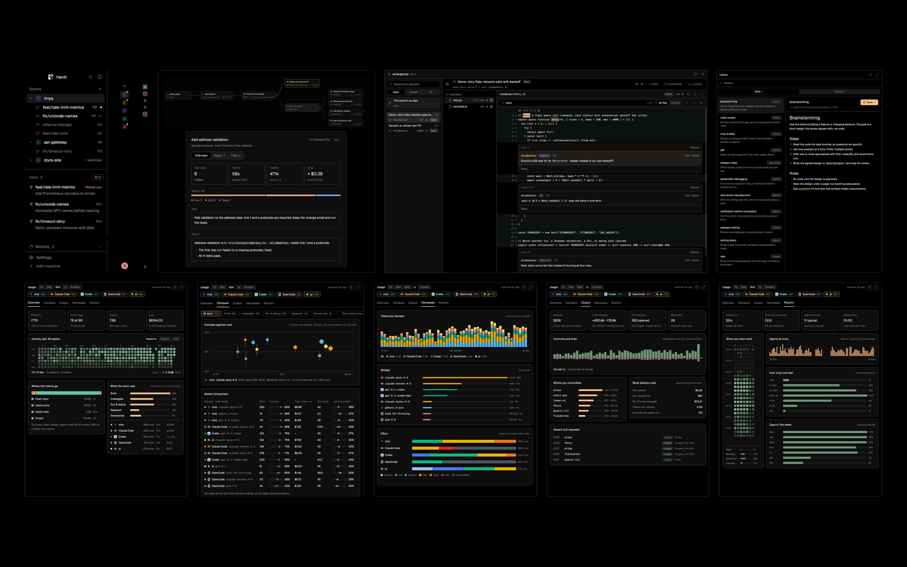

## Install

Tell your Herdr agent:

> Read ~/.config/herdr-app/AGENTS.md, then add this layout by running its install.sh: https://github.com/shoaibkhanz/emergence

Or run it yourself:

```sh
curl -fsSL https://raw.githubusercontent.com/shoaibkhanz/emergence/main/install.sh | bash
```

It clones to `~/code/emergence` (`EMERGENCE_DIR` moves it), links every mod and its agent skill (into
`~/.claude/skills`), adds the [keys](#keys) and switches to the `emergence` layout (`⌘⇧L` cycles back). Old copies of its mods are moved to
`~/.config/herdr-app/replaced/`. Needs Herdr 0.1.15+, `git`, `python3`; `gh` (or `glab`) for pull requests; Graphviz
(`brew install graphviz`) for agents' Excalidraw drawings. To update later, see [Update](#update-or-remove).

## What you get

Screenshots use made-up data.

### Agents (⌘⇧A)

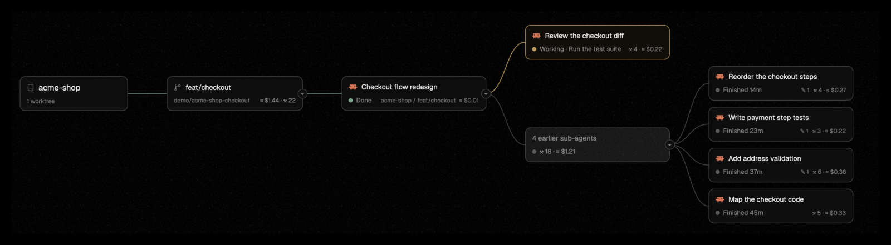

Every agent as repo → worktree (with its PR) → agent → sub-agents, Claude Code's and omp's in-process ones included.
Blocked in red, working in amber, done in green; **Active | All** at the top right (A): it opens on Active while an
agent works or needs you, else on All. Every card shows its tool calls and cost (⚒ 22 · ≈ $1.44; ≈ is an estimate at
API prices on a subscription), a worktree adds up everything under it, and ✎ counts the files a sub-agent edited.
Finished sub-agents fold into "4 earlier sub-agents"; ← / → or the chevrons fold and unfold any card. **Graph | List**
switches the view. Click an agent to jump to it, a PR to review it.

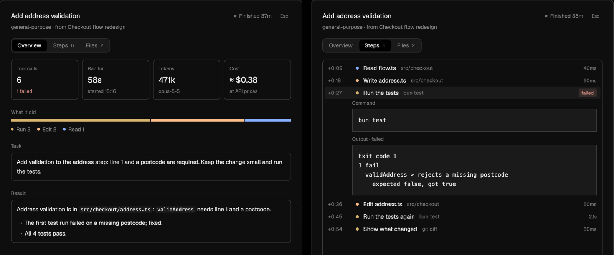

Click a sub-agent (or ↵) for **what it did**:
- **Overview**: tool calls (and how many failed), how long it ran, tokens and model, cost, the kinds of work it did, its task and its result.
- **Steps**: every tool call on a timeline with how long it took, failures in red. Runs of the same kind fold, and Space opens one to show its command and the start of its output.
- **Files**: what it edited (uncommitted marked) and what it read.

It refreshes every 5 s while the sub-agent runs; **Go to agent** (↵) jumps to the agent that started it. Transcripts
are read when you open them and never stored; Claude Code keeps them about 30 days.

### PRs (⌘⇧R)

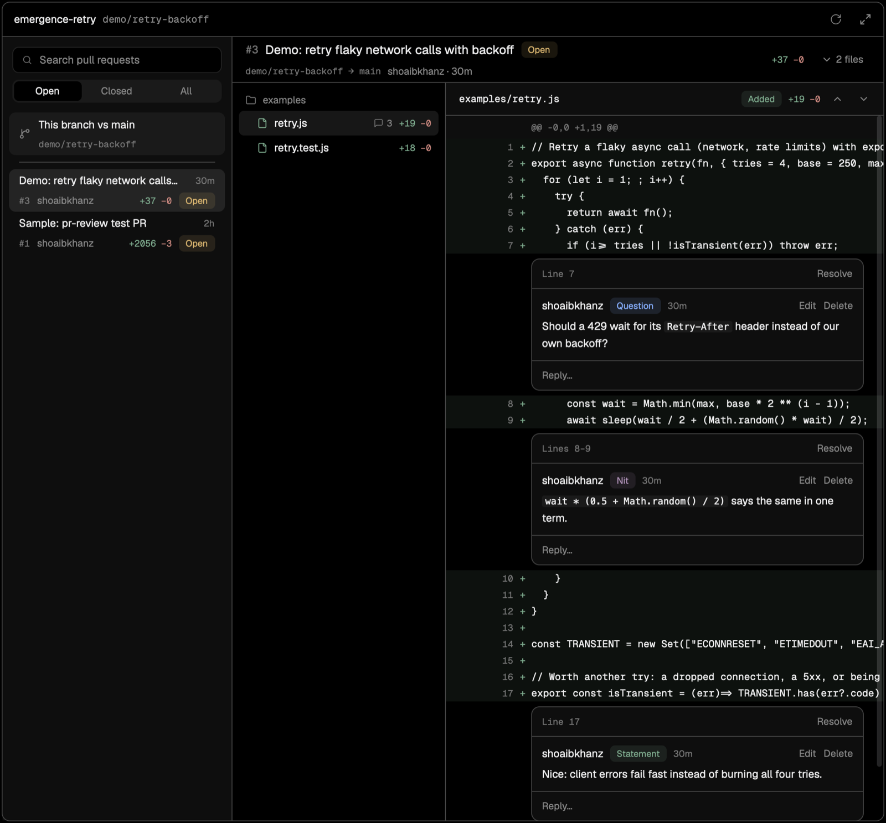

The sidebar keeps its two kinds of comparison apart. **Compare two branches**: pick both sides (`branch ▾ vs main ▾`),
your uncommitted changes included when the first is the branch you're on. **Pull requests**: the repo's GitHub PRs
or GitLab merge requests (search, Open · Closed · All), each comparing its own branch with the one it merges into
(`feat/x → main`). Either opens a file tree and unified or side-by-side diffs with inline threads. Comments carry a
tag (Statement · Question · Nit · Minor · Major) that posts as a badge. Find (⌘F) across code and comments, step
through commits with [ ], reply, edit, resolve. Refreshes every 5 s. Full size keeps the agent's terminal beside
it; it also opens in its own window.

### Library (⌘⇧K)

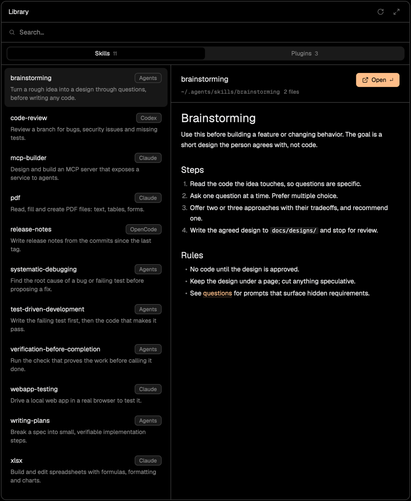

Every skill in `~/.agents`, `~/.claude`, `~/.codex`, `~/.config/opencode` and the repo, plus Claude Code plugins, in
one searchable list showing where each lives.

### Excalidraw (⌘⇧E)

A whiteboard in the side panel, drawn natively by Herdr (no browser). Drawings are ordinary `.excalidraw` files. Dark
themes get a black canvas, light themes a white one, with the Agents graph's background and grain underneath.
**All drawings ⌘O** opens the library (previews, search, pin, rename, repos, and a Trash tab that keeps deleted drawings
30 days, with Restore); **Full size** opens the drawing in a big window; **SVG** and **PNG** export it to Downloads as the
canvas shows it (background, pattern and grain, the Excalifont embedded; also `herdr-app do excalidraw.export-svg` /
`export-png`). ⌘C, ⌘X and ⌘V copy and paste shapes, also
to and from excalidraw.com. Drag from the dots on a shape's edges to connect it; hold ⌘ and press an arrow key to
preview connected copies that way (press again for more), then let go or press ↵ to add them; ⌥ and an arrow key moves
to the connected shape. Agents draw on it too, through the `herdr-excalidraw` skill: ask "draw how checkout works in
Excalidraw".

### Usage (⌘⇧U)

Cost and output across omp, Claude Code, Codex, OpenCode and pi, from their local logs and your git history. Any
period; drag across a chart and every number follows, until you clear the pick (✕ on its chip, top right). **Skills**
shows which of your skills do well across every harness: how often each is used, how its sessions do against the same
harnesses' sessions without it (commits, median cost, clean runs), by harness and model, and by category. Nothing
leaves your machine.

<table>
<tr>
<td width="50%">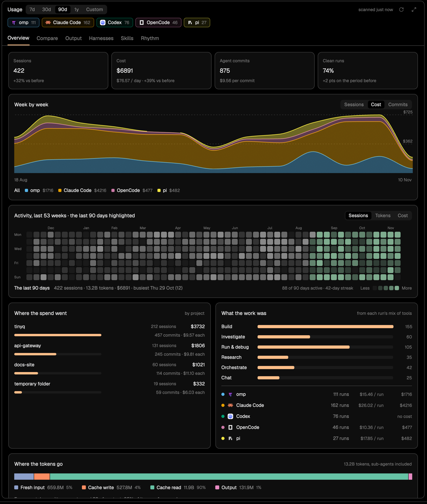<br><b>Overview.</b> Sessions, cost, agent
commits and clean runs against the period before; the period day by day; where the spend went, by project.</td>
<td width="50%">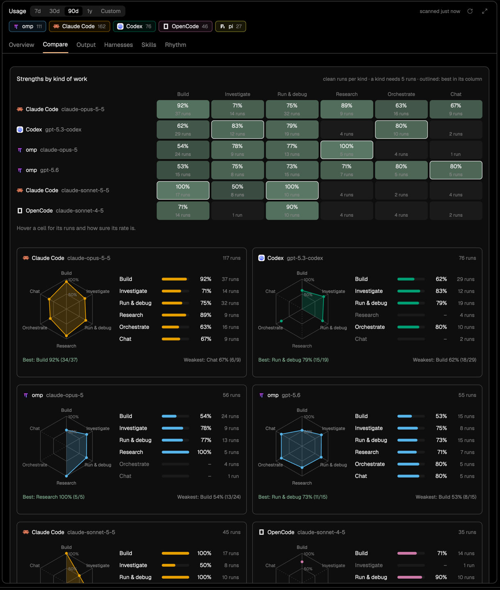<br><b>Compare.</b> What each harness and
model is best at, by kind of work; above it, clean-run rate, cost per clean run and commits per pair.</td>
</tr>
<tr>
<td>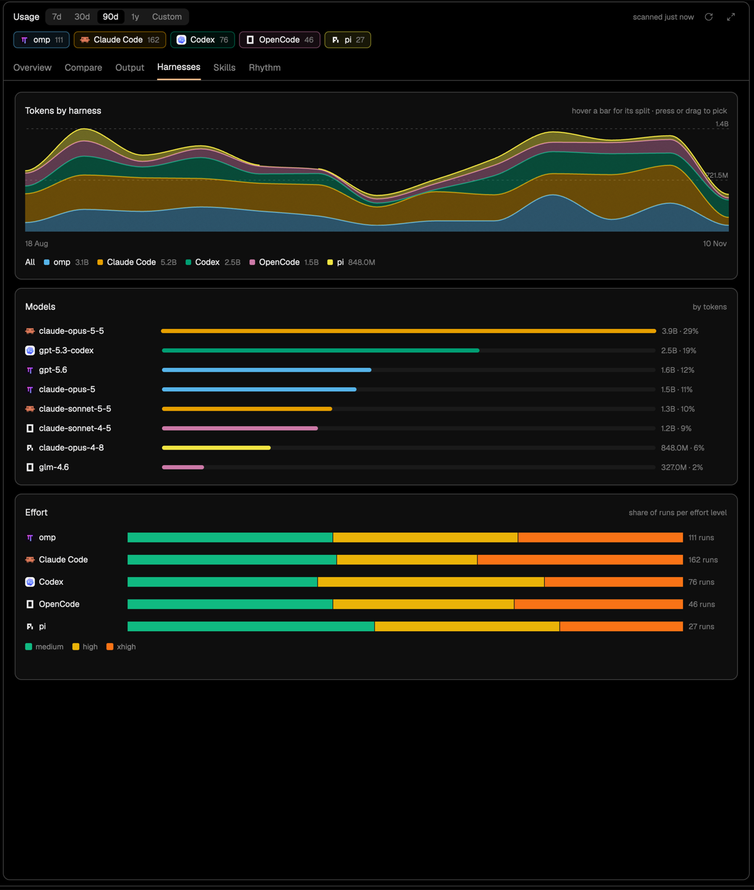<br><b>Harnesses.</b> Tokens, models and effort
per harness over time.</td>
<td>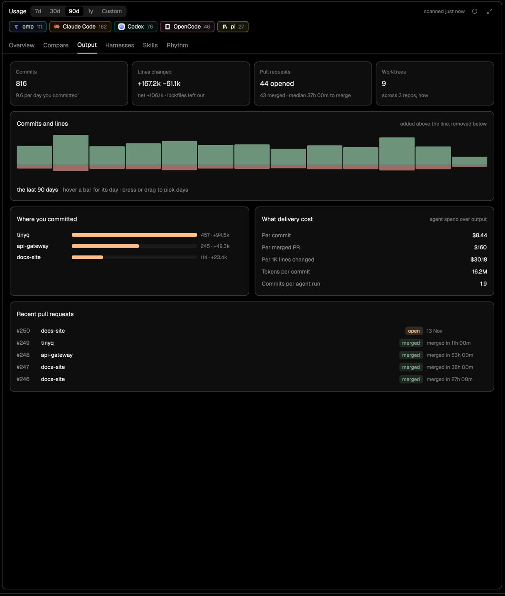<br><b>Output.</b> Commits, lines, PRs, worktrees, and
their cost.</td>
</tr>
<tr>
<td>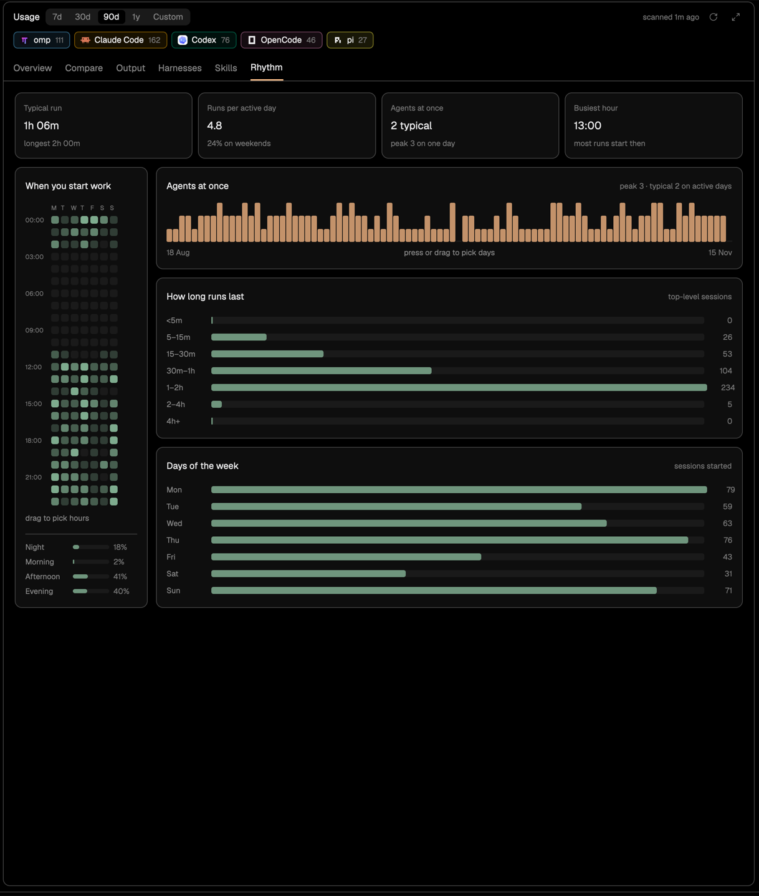<br><b>Rhythm.</b> When you work, agents at once, run
lengths.</td>
<td>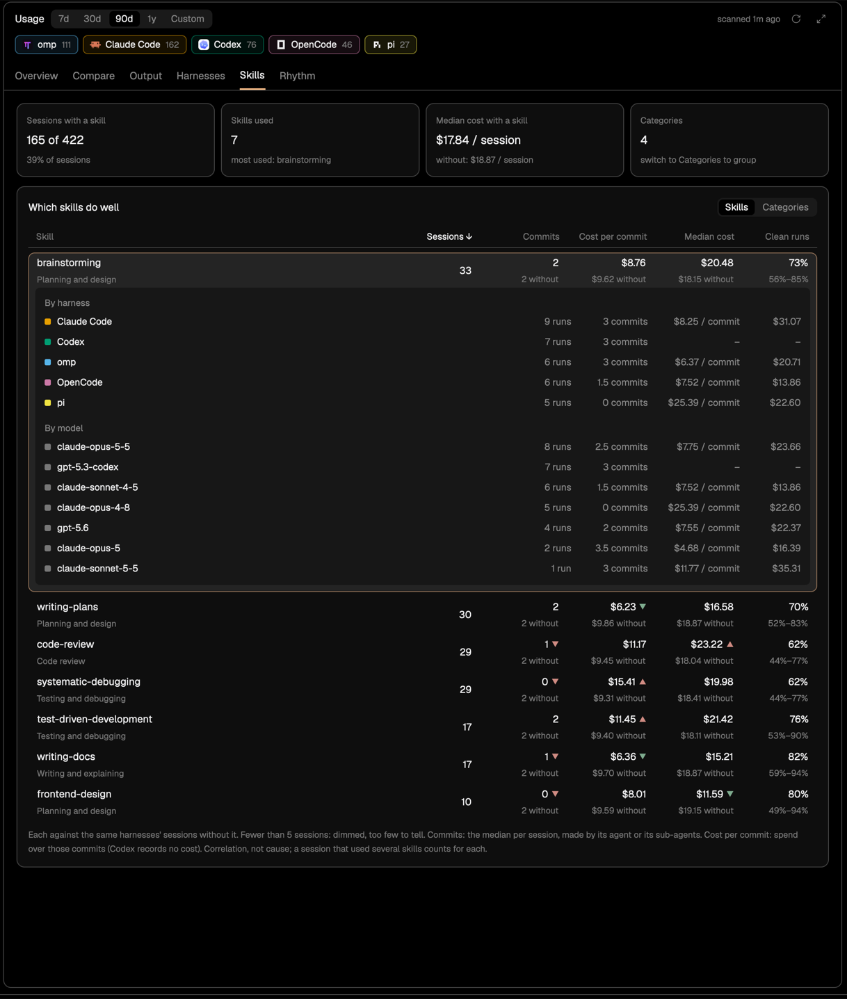<br><b>Skills.</b> Each skill against the same
harnesses' sessions without it: commits, cost per commit, median cost, clean runs; by harness and model.</td>
</tr>
</table>

Only this machine's logs count. Claude Code prunes transcripts after 30 days (`cleanupPeriodDays`); Usage keeps every
session it has read.

### Sidebar

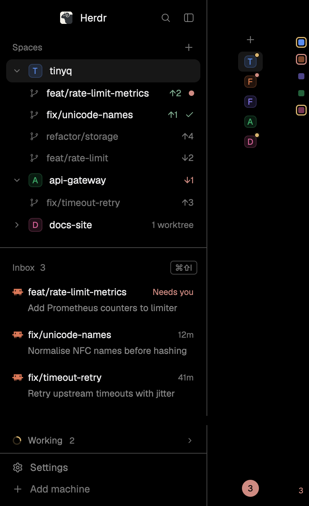

- **Spaces**: every worktree under its repo, with ↑/↓ commits and agent status. Worktrees with no space open fold into
  **Other worktrees** (→ or ↵ lists them greyed, ↵ opens one); its **Clean up…** opens the bulk delete with the merged ones ticked.
  On a worktree, ← deletes it (`git worktree remove`; refused with uncommitted changes, branch kept) and → archives it
  (hidden, still on disk; reopen from ⌘E). Right-click for the same. Both ask first (Cancel selected), then leave
  the keyboard in Spaces.
- **Inbox**: every agent waiting on you, newest first, including a blocked sub-agent another agent started (click to
  peek at it); Settle puts one away.
- **Ports**: every server listening on this Mac and the agent that started it. One started outside Herdr says by
  what ("Claude app", "Codex in iTerm"); "Claude ended" means the session that started it has ended but the server
  still runs (amber past an hour); a half-strength icon means probably that agent (started in the background, matched
  by folder); a globe means your network can reach it. Click (or ↵) for its card: address, agent, command, uptime, CPU
  and memory, with Open, Go to agent and Stop (asks first, and checks the process still holds the port).
  Deleting a clean worktree whose branch has commits nowhere else (not pushed or merged) says so in amber; the branch
  keeps them. ⇧← ticks several worktrees to delete at once.
- **Working N**, the last row: opens the graph on what's working (everything at 0).
- **Sizes**: open, rail, dots (⌘B, ⌘⌥B).
- **Drag the lines** between Spaces, Inbox, Ports and Side chats: a section keeps the size you give it (it scrolls
  past that); the rest fit their content. Settings (⌘⌥,) → Dragged sizes off fits them all again.

### Settings (⌘⌥,)

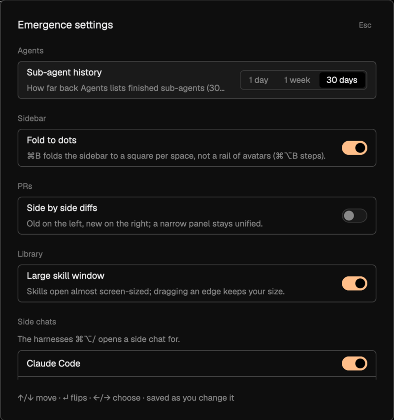

Every switch the mods keep, in one dialog, saved as you change it: how far back Agents lists finished sub-agents
(1 day, 3 days or 1 week), what's behind the Agents graph (sparse dots by default; gravity, fading or isometric dots, graph paper, topographic lines, or none), how strongly it shows and how much film grain sits over it, the sidebar's fold, side-by-side diffs, the Library's window size, and which harnesses a
side chat (⌘⌥/) opens for.

### Status bar

CPU, memory, free disk and (on battery) battery, amber or red when high: CPU at 80%, memory under pressure (not just
full: macOS fills it with cache), disk under 10% / 5% free, battery under 20% / 10%. Click one for **System**: what
each agent and the top processes use (click an agent to go to it; a port chip opens that port's card), and on Disk
the size of every worktree of the repos you have open.

### Jump (⌘E)

Every tab and unopened worktree, most recent first; ⌘E ↵ flips between your last two. Type to filter (a space's name
finds its worktrees too), or a new branch name to make a worktree. Unnamed tabs follow their branch.

## Keys

Added without replacing yours; all but ⌘E only in the `emergence` layout. ⌘⇧/ (or the tab bar's keyboard button)
lists them all. The keyboard stays where you put it until you move it: closing something gives it back to where it
was (Jump, the keys list, a worktree dialog or menu to Spaces, the Inbox or the panel you opened it from; a panel's
window or popup to the panel), and ctrl-h / ctrl-l move it between the terminal and the side panel.

| Key | Where | What |
|---|---|---|
| ⌘E | everywhere | Jump |
| ⌘⇧/ | layout | every Emergence key (⌘/ is Herdr's) |
| ⌘⌥, | layout | Emergence settings |
| ⌘⇧F · ⌘⇧G · ⌘⇧A · ⌘⇧E · ⌘⇧R · ⌘⇧K · ⌘⇧U · ⌘⇧S | layout | the side panel's tabs, open or close: Files · Changes · Agents · Excalidraw · PRs · Library · Usage · Side |
| ⌘⇧I | layout | keyboard into the Inbox |
| ⌘⇧O | layout | worktrees of this repo |
| ⌘B · ⌘⌥B | layout | sidebar open/fold · one size thinner |
| ↑ ↓ (or j k) · ↵ | sidebar | move · open (h l fold in Spaces) |
| ← → | Spaces | repo: fold · worktree: delete / archive |
| ctrl-j · ctrl-k · ctrl-l | sidebar | down (Spaces → Inbox → Ports → Side chats) · up · back to the terminal (also Esc) |
| ↵ · ← | Ports | the port's card · stop it (asks first) |
| ↑ ↓ · ← → · A · ↵ | Agents | select · fold / unfold · Active or All · open (a sub-agent: its details) |
| ← → · ↑ ↓ · Space · ↵ | sub-agent details | tabs · move · open a step · go to its agent |
| ↑ ↓ · ← → · ↵ · Esc | panels | list · tabs · open · step back, then back to the terminal |
| ⌘F · [ ] · ⌘\\ | PRs | find · previous / next commit · hide / show the pull requests |
| ctrl-h · ctrl-l | side panel · terminal | to the terminal · into the side panel |
| ctrl-h/j/k/l | terminals | between panes ([optional](#optional-ctrlhjkl-between-panes)) |

Not ⌘⇧J (Homerow's scroll mode); not ⌘⇧B (Blueprint).

## What it runs

- **Agents**: `git rev-parse` per agent folder; `gh pr list` (or `glab mr list`) per repo each minute;
  `mods/agent-graph/subagents.py` reads Claude Code's and omp's session logs for sub-agents, tool calls and cost
  (file paths, short labels and counts only, cached in Herdr's `data/agent-graph/`), and a sub-agent's whole
  transcript only while its details are open (never cached).
- **PRs**: `git` and `gh` (or `glab`, by the repo's remote) in the focused repo; comments go through that forge's API.
- **Library**: lists the skill folders above and `~/.claude/plugins/installed_plugins.json`.
- **Usage**: `mods/usage/scan.py` reads session logs (counts, models, timestamps, and the `git commit` calls agents
  ran; never prompts), cached in Herdr's `data/usage/`; `output.py` runs `git log` (diffing each commit once), `gh`/`glab` and `git worktree list`.
- **Spaces**: `git rev-parse`, `rev-list`, `worktree list`, `for-each-ref`; delete runs `git worktree remove`.
- **Tab bar**: an hourly `git fetch` of `main` into your clone, for the [Update](#update-or-remove) chip.
- **Excalidraw**: reads and writes drawings in `~/.config/herdr-app/data/excalidraw`; the agent skill runs `dot`.
- **Inbox**: nothing outside Herdr.
- **Status bar**: `ps`, `vm_stat`, `sysctl` every 5 s; `df` and `pmset` each minute. System, while open: the same, plus
  `lsof` once and, on Disk, `git worktree list` and `du -sk` per worktree (kept 5 minutes).
- **Ports**: `lsof` and `ps` every 5 s while the sidebar is open, `git rev-parse --show-toplevel` once per agent
  folder; the card runs `ps` on its one process, and Stop runs `lsof` on it, then `kill` (SIGTERM).

## Update or remove

**Update**: when `main` has new commits, an **Update** chip appears in the tab bar (it checks at start and then
hourly). Click it: it pulls, relinks new mods and keys, and reloads the layout. It only appears for a clone on `main`
with no commits of its own; otherwise pull yourself and rerun the install command above.

**Remove**: `herdr-app do layout.switch --name main`, delete the links
(`find ~/.config/herdr-app/mods ~/.config/herdr-app/layouts ~/.claude/skills -maxdepth 1 -lname "$HOME/code/emergence/*" -delete`,
with your `EMERGENCE_DIR` if you moved it), then remove the `tabs-plus.*`, `side.chat`, `mod.open:jump`,
`mod.open:emergence-keys`, `mod.open:emergence-settings`, `mod:spaces-plus`, `mod:inbox`, `mod:ports` and
`mod:side-chats` entries from `~/.config/herdr-app/keys.json` and `omp` from `programs.json`, and delete the clone.
Drawings stay in `~/.config/herdr-app/data/excalidraw`.

## Optional: ctrl-h/j/k/l between panes

`nav-keys` moves between panes, handing the key to (n)vim where it runs. Bind it (the keys then stop reaching your
shell):

```json
"terminal": { "ctrl-h": "nav-keys.left", "ctrl-j": "nav-keys.down", "ctrl-k": "nav-keys.up", "ctrl-l": "nav-keys.right" }
```

To also leave (n)vim at a split edge, add [herdr-nav-plus](https://github.com/shoaibkhanz/herdr-nav-plus)'s editor
map (`editor/vim.vim` for Vim):

```sh
mkdir -p ~/.config/nvim/after/plugin
curl -fsSL https://raw.githubusercontent.com/shoaibkhanz/herdr-nav-plus/main/editor/nvim.lua \
  -o ~/.config/nvim/after/plugin/herdr_nav.lua
```

## Develop

| Path | What |
|---|---|
| `mods/agent-graph`, `pr-review`, `skills`, `usage`, `excalidraw` | the side panels |
| `mods/side`, `side-chats` | side chats beside an agent, and their rows in the sidebar |
| `mods/inbox`, `spaces-plus`, `ports` | the sidebar |
| `mods/port-card` | a port's card |
| `mods/status-plus` | the status bar and its System popup |
| `mods/tabs-plus` | tab bar, panel buttons, tab names, updates |
| `mods/jump` | ⌘E |
| `mods/emergence-keys` | ⌘⇧/ |
| `mods/emergence-settings` | ⌘⌥, |
| `mods/confirm-safe`, `row-menu`, `worktree-sweep` | Cancel-first confirm; right-click menu; bulk worktree delete |
| `mods/nav-keys` | ctrl-h/j/k/l |
| `skills/herdr-excalidraw` | the agent skill for drawing on Excalidraw |
| `layouts/emergence.json` | the layout |
| `RECIPE.md` | how to rebuild it |

`spaces-plus`, `tabs-plus`, `status-plus` and the layout are copies of Herdr 0.1.15's own.

```sh
herdr-app check ~/.config/herdr-app/mods/<name>   # load and render once
(cd mods && bun test)                              # every mod; also python3 mods/usage/test_scan.py,
                                                  # python3 mods/agent-graph/test_subagents.py, python3 mods/side/test_side.py,
                                                  # python3 skills/herdr-excalidraw/test_dot2excalidraw.py
bash install.test.sh                              # the installer and updater, in throwaway homes
ln -s ../../scripts/pre-push .git/hooks/pre-push  # once: tests and herdr-app check on every mod before a push
```

Every push to `main` reaches people through the Update chip, so CI (`.github/workflows/check.yml`) runs all of the
above but `herdr-app check` on each push, and `main` is never force-pushed (clones could no longer fast-forward).

Edits need a reload: switch to `main`, then back to `emergence`. Read [`docs/platform-notes.md`](docs/platform-notes.md)
first.

MIT ([`LICENSE`](LICENSE)). Icons: [Lucide](https://lucide.dev) (ISC); omp's icon is its own (MIT). The Excalidraw mod is coyaSONG's
(MIT), copied from [herdr-orca](https://github.com/VladTemp27/herdr-orca); it bundles Excalidraw (MIT) and Excalifont
(OFL): see [`mods/excalidraw/SOURCE.md`](mods/excalidraw/SOURCE.md).
