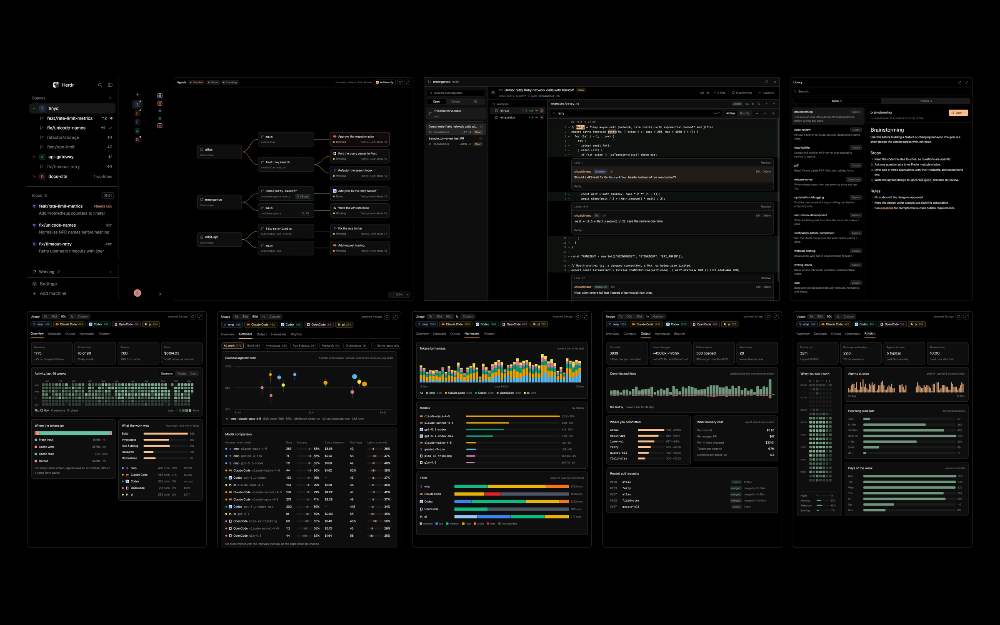
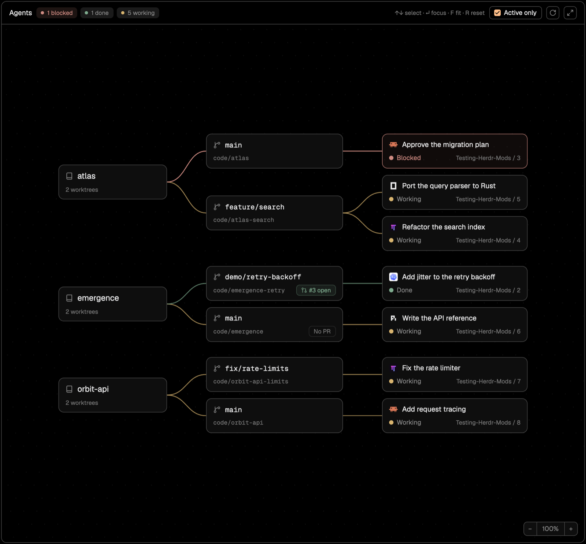
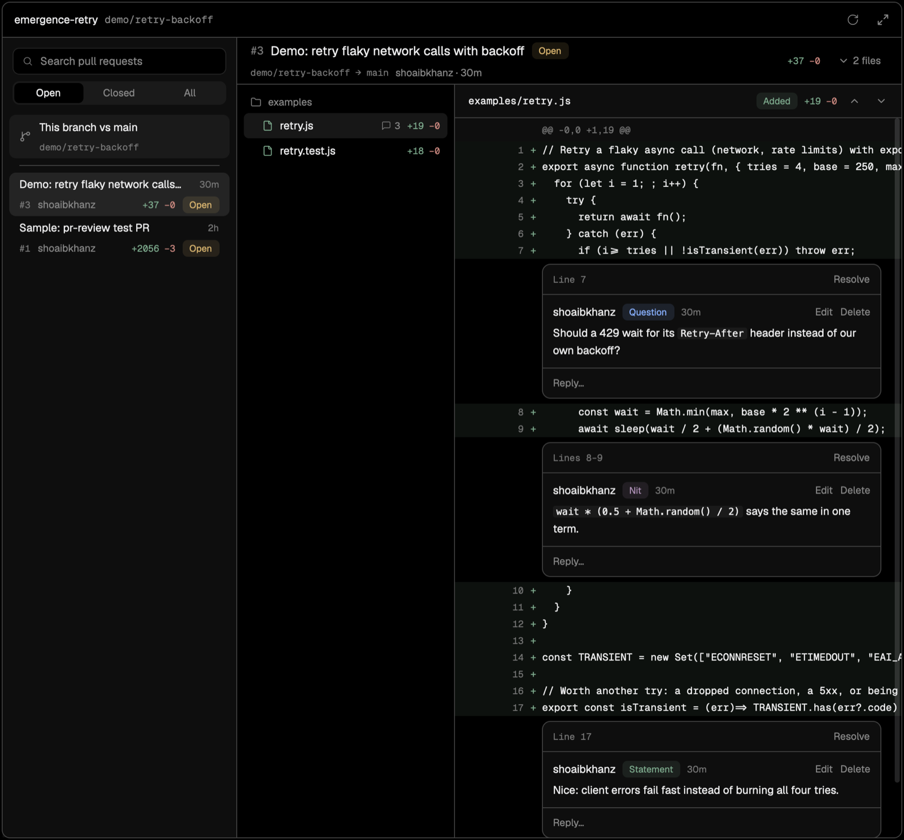
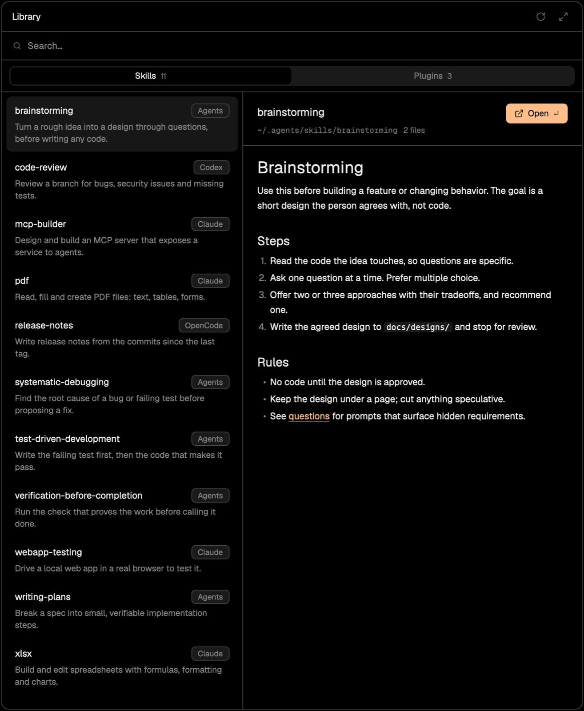
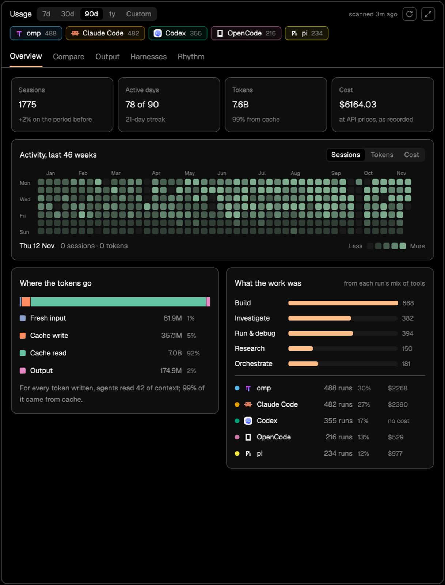
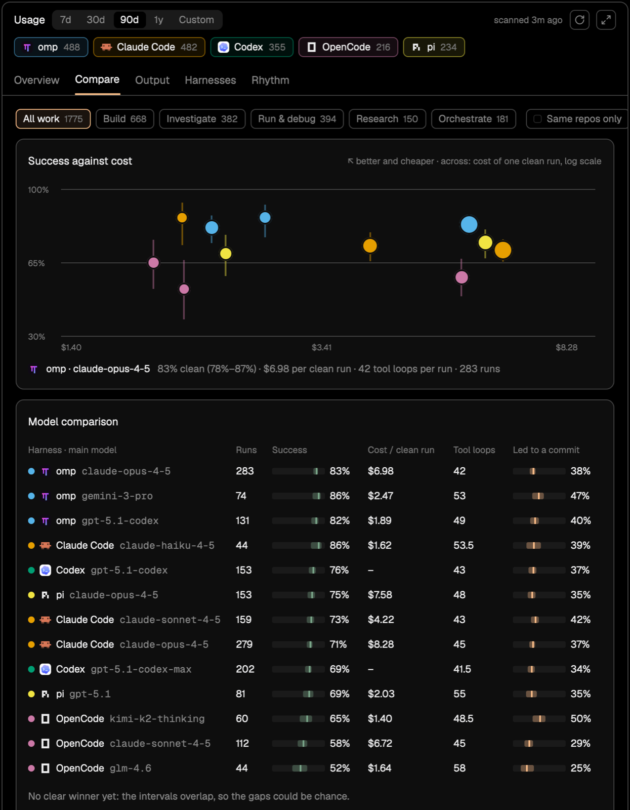
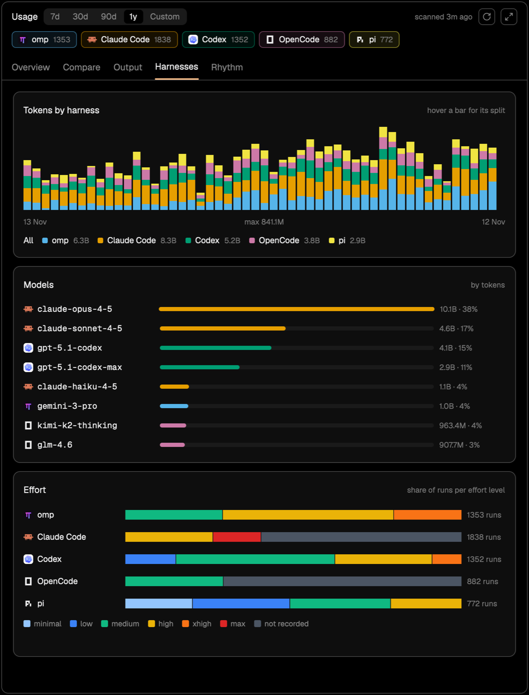
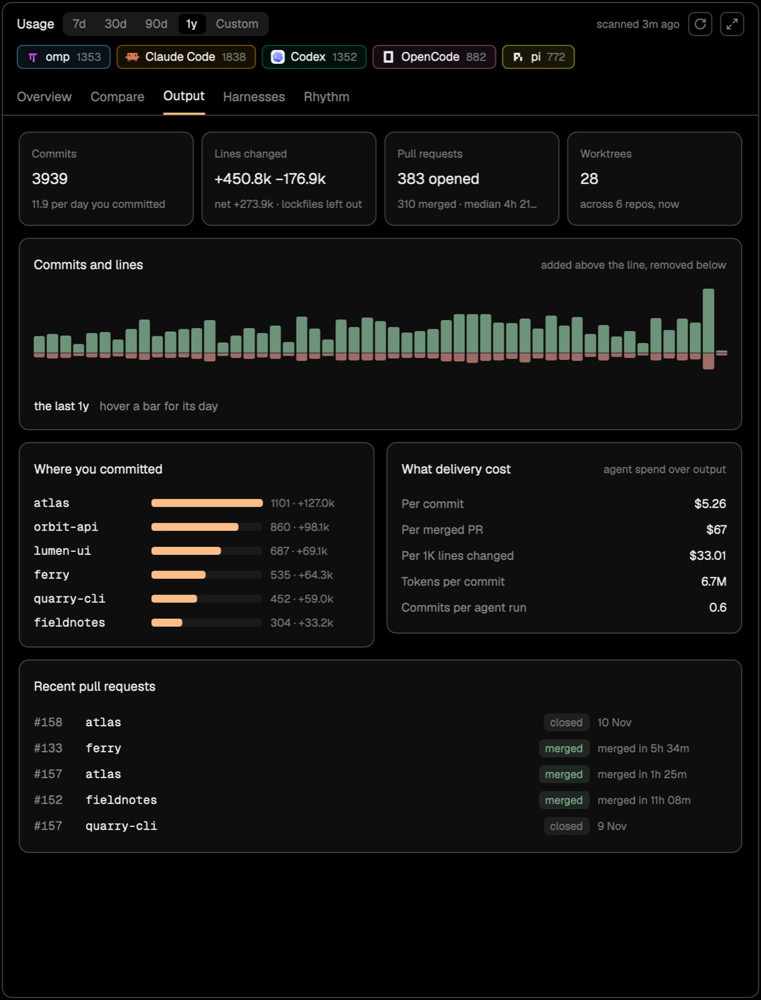
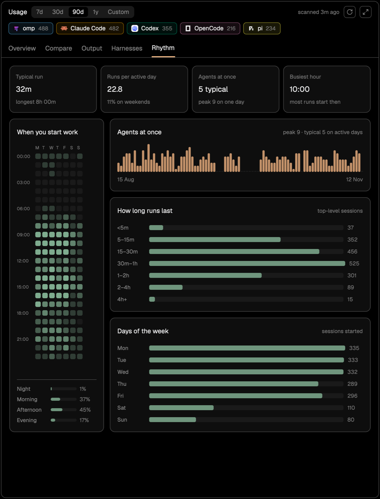
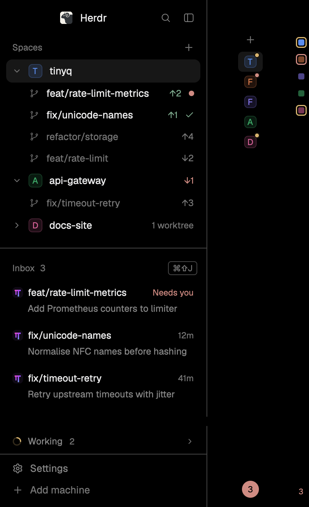

# Emergence

A layout for the [Herdr app](https://herdr.dev) for running many coding agents at once: every agent as a graph, a
pull request reviewer, a skills and plugins library, usage analytics across harnesses, and an inbox for the agents
that need you.



## Install

Tell your Herdr agent:

> Read ~/.config/herdr-app/AGENTS.md, then add this layout by running its install.sh: https://github.com/shoaibkhanz/emergence

Or run one command yourself:

```sh
curl -fsSL https://raw.githubusercontent.com/shoaibkhanz/emergence/main/install.sh | bash
```

It clones this repo to `~/code/emergence`, links every mod into Herdr, adds the keys below without replacing any you
have (all but ⌘E act only in the `emergence` layout, whose tab bar runs them), and switches to that layout (`⌘⇧L`
cycles back to Herdr's own). When this repo changes, an **Update** chip appears in the tab bar; click it to pull,
relink and reload.

Needs Herdr 0.1.15 or newer, `git` and `python3`; `gh` signed in for pull requests, `glab` for GitLab merge requests.
The fonts (Geist, Geist Mono) ship with Herdr.

## What you get

Four panels open from buttons in the tab bar (each also opens large from its corner button), and the sidebar becomes
an inbox. Every screenshot below uses made-up data.

### Agents (⌘⇧A): who's running, where, and who needs you



Every agent on the machine in one picture: repo → worktree, with the PR it has open → agent → its sub-agents. With a
dozen agents running, the one that's blocked shows in red and the finished one in green, so you see where to look
without visiting each tab. Click an agent to jump to it, a PR to review it, a repo to list its worktrees. Drag cards
around; the wheel zooms.

### PRs (⌘⇧R): review your agents' work without leaving Herdr



The PRs of the repo you're in, plus a compare of any two branches (this one against main to start). Changed files form a tree, with
one diff at a time, unified or side by side, and review threads inline; long lines scroll sideways. Select lines and
comment, tagged Statement · Question · Nit · Minor · Major. The tag posts as a coloured badge on GitHub, so whoever
picks up the review (you, or the agent) can tell a nit from a blocker at a glance.
Find (⌘F) searches the code and review comments of the whole PR (or just the open file), stepping from match to match.
Comment authors and @mentions stand out from the text. The commit history lists the PR's commits; open one to review
just its changes, and step through them with [ and ]. Click a hunk header to show the unchanged lines it hides, or
show the whole file from the file's header. Comments on the PR itself and reviews sit under the conversation, with a box
to answer (tags too); edit or delete your comments there, and ⌘F searches it. It all refreshes every 5 seconds, so you
watch an agent's comments and pushes land. Reply, edit,
delete and resolve threads here too. For more room, hide the PR list beside an open PR, or go full size: the
sidebar folds away and the agent's terminal stays on the left, so you watch its comments land as it works. The review
also opens in its own window, centred and nearly full screen; drag its right or bottom edge to any size.

### Library (⌘⇧K): every skill your agents can load



Skills from `~/.agents`, `~/.claude`, `~/.codex`, `~/.config/opencode` and the repo, plus your installed Claude Code
plugins and the skills they ship. It's one searchable list that shows where each skill lives, so you can check what's
already installed before writing or copying another. Each skill opens in a reusable window.

### Usage (⌘⇧U): what your agents cost, and what they deliver

How you work across omp, Claude Code, Codex, OpenCode and pi, read from their own logs and your git history. Pick 7,
30 or 90 days, a year, or two dates. It rescans every minute while it's open. Nothing leaves your machine.

<table>
<tr>
<td width="50%"></td>
<td width="50%"></td>
</tr>
<tr>
<td valign="top"><b>Overview.</b> Sessions, active days, tokens and spend, against the period before. A calendar shows
every day, and the breakdowns show where tokens go (fresh input, cache writes, cache reads, output) and what kind of
work it was. Agents re-read their context on every step, so the cache share tells you whether long runs are cheap or
expensive.</td>
<td valign="top"><b>Compare.</b> For each harness and model: the share of runs that went cleanly (no abort, API error
or compaction, few failed tools) with its 95% range, what one clean run costs, tool calls per run, and how often a run
led to a commit. A winner is only named when the ranges don't overlap, so you switch tools on evidence.</td>
</tr>
<tr>
<td width="50%"></td>
<td width="50%"></td>
</tr>
<tr>
<td valign="top"><b>Harnesses.</b> Tokens by harness over time, the models that carry the load, and the effort level each
harness runs at. A move from one harness or model to another shows up week by week.</td>
<td valign="top"><b>Output.</b> What the spend produced: commits, lines changed, pull and merge requests, worktrees. Then
what that delivery cost, per commit, per merged PR and per 1K lines.</td>
</tr>
<tr>
<td width="50%"></td>
<td valign="top"><b>Rhythm.</b> When you start work, how many agents run at once on each day, and how long runs last.
Find the hours you run the most agents, and the runs that drag on.<br><br>
Hover any bar or square for its numbers. Press or drag across days, bars or hours (say 09:00–12:00) and every other
number follows; ✕ shows the whole period again. Cost is what each harness recorded, at API prices (Codex records none). The
kind of work comes from each run's mix of tool calls, never from your prompts.</td>
</tr>
</table>

**Usage only sees what's on this machine.** It reads the session logs each harness keeps locally and the git repos
those sessions ran in. Work done on another computer isn't counted, and neither is history a harness already deleted.
Claude Code deletes transcripts after 30 days by default (`cleanupPeriodDays` in `~/.claude/settings.json`), so a first
scan sees about a month of Claude Code. From then on, Usage keeps every session it has read, even after Claude Code
prunes it. Raise `cleanupPeriodDays` to keep more.

### Sidebar



- **Spaces**: every worktree sits under its repo's space, with its ↑/↓ commits and what its agent is doing (amber dot:
  needs you, spinner: working, check: done). Worktrees with no space yet are greyed; click one (or ↵) to open it.
  Fold a repo with its chevron (or ←/→); folds are remembered. Spaces grows with its rows and pushes the inbox down.
- **Inbox** (after [T3 Inbox](https://github.com/JinJieBeWater/herdr-t3-inbox)): a two-line row for every agent
  waiting on you (blocked, finished, or idle for its next prompt): branch and age, then its task. Working agents fold
  into one row that opens the graph. Settle puts a row away until its agent needs you again.
- **Three sizes**: open, a rail of letter cells with a status dot, or dots (one square per space, ringed when it needs
  you or is working). Folded, the inbox shows only how many need you. ⌘B opens and folds it, ⌘⌥B goes one size thinner.
- **Keyboard**: ⌘B puts the keyboard in the list (so does ctrl-h from the leftmost terminal, with nav-keys bound);
  see [Keys](#keys).

### Jump (⌘E): every session and worktree, most recent first

One list of every tab in every space, plus the worktrees of your open repos that aren't open yet. The tab you're on is
at the top and the one before it is picked, so ⌘E ↵ flips between your last two. Each row shows what its agent is
working on and for how long, so you can tell sessions apart at a glance. Type to filter by tab, branch, folder, agent or task. Type a
new branch name to make a worktree for it.

Unnamed tabs take the name of their branch (or the repo, on main), and follow it as the branch changes; a name you
give a tab stays.

Its keys are with every other under [Keys](#keys).

## Keys

The installer adds these without replacing any key you already have. All but ⌘E act only in the `emergence` layout.

| Key | Where | What |
|---|---|---|
| ⌘E | everywhere | Jump: every session and worktree |
| ⌘⇧A · ⌘⇧R · ⌘⇧K · ⌘⇧U | layout | open or close Agents · PRs · Library · Usage (the panel takes the keyboard) |
| ⌘⇧J | layout | the next agent that needs you |
| ⌘⇧O | layout | every worktree of the repo you're in |
| ⌘B | layout | sidebar: open it with the keyboard in Spaces; in it, fold it (to the last folded size) |
| ⌘⌥B | layout | sidebar one size thinner: open → rail → dots → open |
| ↑ ↓ · ↵ | sidebar | move · open the space or worktree, or go to the agent |
| ← → | Spaces | fold or unfold a repo; ← on a worktree goes to its space |
| ctrl-j · ctrl-k | sidebar | Spaces → Inbox · Inbox → Spaces |
| ctrl-l · Esc | sidebar | back to the terminal you came from |
| ↑ ↓ · ← → · ↵ · Esc | panels | step through the list · switch tabs (PR states in PRs) · open · close |
| ⌘F · [ ] | PRs | find across the PR · previous and next commit |
| ctrl-h/j/k/l | terminals | move between panes, with [nav-keys](#optional-ctrlhjkl-between-panes) bound (optional) |

## What it runs

- **Agents**: `git rev-parse` in each agent's folder, and `gh pr list` once a minute per repo.
- **PRs**: `git` and `gh` in the focused repo; posting a comment, reply, edit, delete or resolve calls the GitHub API.
- **Library**: lists skill folders under `~/.agents`, `~/.claude`, `~/.config/opencode`, `~/.codex` and the repo, and
  reads `~/.claude/plugins/installed_plugins.json`.
- **Usage**: `python3 mods/usage/scan.py` reads the harnesses' session logs (omp, Claude Code, Codex, OpenCode, pi) and
  keeps a cache in Herdr's `data/usage/`; `python3 mods/usage/output.py` runs `git log`, `gh pr list` or `glab mr list`
  and `git worktree list` in the repos those sessions name. Only counts, models and timestamps are read, never prompts.
- **Tab bar**: every 6 hours, `git fetch` of this repo's `main` (public HTTPS) into your clone; **Update** runs
  `git merge --ff-only` and `install.sh` there. Nothing for a copy that isn't a clone of this repo, or one on another
  branch or with your own commits.
- **Spaces**: `git rev-parse`, `symbolic-ref` and `rev-list` in each space's folder (branch, ahead/behind), and per
  repo `git worktree list` and `git for-each-ref` (its worktrees and their ahead/behind).
- **Inbox**: nothing outside Herdr.

## Update or remove

Update: click **Update** in the tab bar when it shows (it checks every 6 hours), or run the install command again.
Either one reloads the layout, so the new mods run straight away.
If you installed by copying the files, run the install command once to switch to a clone.

Remove: switch back with `herdr-app do layout.switch --name main`, delete the links
(`find ~/.config/herdr-app/mods ~/.config/herdr-app/layouts -maxdepth 1 -lname "$HOME/code/emergence/*" -delete`),
then take the `tabs-plus.*` and `mod.open:jump` keys out of `~/.config/herdr-app/keys.json` and the `omp` entry out of `programs.json`.

## Optional: ctrl-h/j/k/l between panes

`nav-keys` moves focus between panes, but where the focused terminal runs (n)vim it passes the key to the editor. It
does nothing until you bind it in `~/.config/herdr-app/keys.json`, because the keys then stop reaching your shell
(ctrl-l clear, ctrl-k kill line):

```json
"terminal": { "ctrl-h": "nav-keys.left", "ctrl-j": "nav-keys.down", "ctrl-k": "nav-keys.up", "ctrl-l": "nav-keys.right" }
```

It only runs in the `emergence` layout (a 0px block); in other layouts these keys then fail. The sidebar takes ctrl-j/k/l
itself, with or without nav-keys. Leaving (n)vim with them needs an editor mapping this repo doesn't ship: move between
splits and, at the edge, run `herdr-app do pane.go --direction <left|down|up|right>`. Without one the keys stay inside
the editor.

## Develop

| Path | What |
|---|---|
| `mods/agent-graph`, `pr-review`, `skills`, `usage` | the four panels |
| `mods/inbox`, `spaces-plus` | the sidebar |
| `mods/tabs-plus` | Herdr's tab bar with the panel buttons; names tabs and records the order you visit them |
| `mods/jump` | the ⌘E switcher |
| `layouts/emergence.json` | Herdr's `main` layout with all of the above |
| `RECIPE.md` | the brief to rebuild it from scratch |

`spaces-plus`, `tabs-plus` and the layout are copies of Herdr 0.1.15's own; Herdr updates don't flow into them.

```sh
herdr-app check ~/.config/herdr-app/mods/<name>   # loads and renders once
(cd mods/<name> && bun test)                      # logic tests; Usage also: python3 mods/usage/test_scan.py
```

Edits don't reach open panels: switch layouts (`main`, then `emergence`) to restart them. Read
[`docs/platform-notes.md`](docs/platform-notes.md) before changing anything.

MIT licensed (see [`LICENSE`](LICENSE)). Icons from [Lucide](https://lucide.dev) (ISC); omp's icon is its own (MIT).
