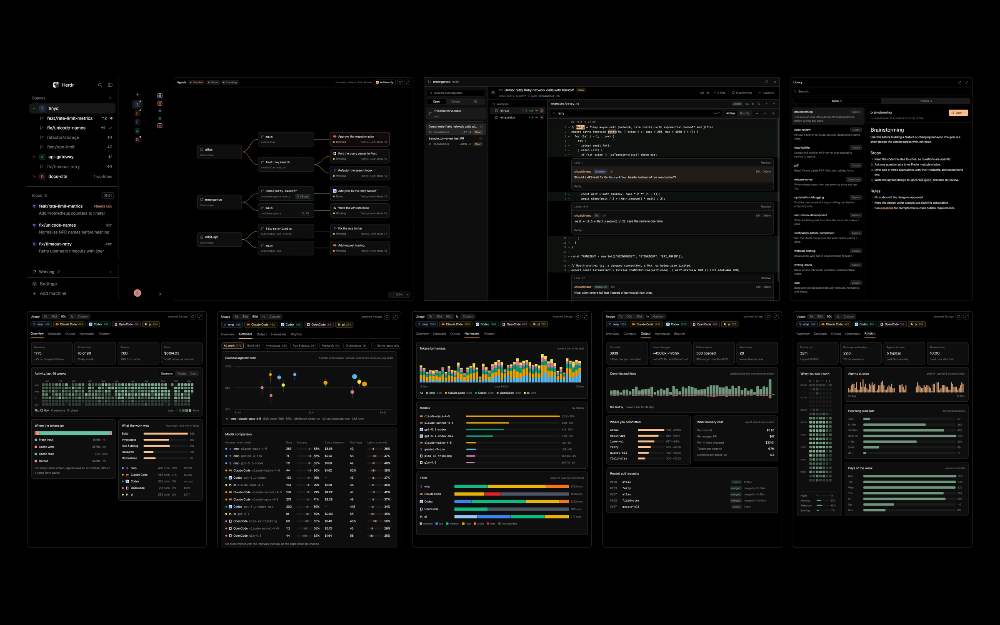

# Emergence

A layout for running many coding agents at once. The tab bar gains four side panels: every agent as a graph
(repo → worktree with its PR → agent → sub-agents), a pull request reviewer, a library of skills and Claude Code plugins,
and usage analytics across omp, Claude Code, Codex, OpenCode and pi. In the sidebar, an inbox holds a card for each
agent waiting on you and folds working ones away. For herdr-app 0.1.15.

To add it, run this repo's `install.sh` rather than copying the files: it links the mods to a git clone, so the tab
bar's Update chip can keep them current. A copy works but never updates.

## What you see

Left to right, no title bar, the theme's `canvas` behind cards, 1px `border` dividers:

- **Sidebar** (268px, 14–480, `chrome`):
  - The brand row (46px, Herdr's `workspace-chrome`).
  - **Spaces** (`spaces-plus`), sized to its rows: header 31px plus 30px a row, 8 rows at most, then it scrolls. The
    avatar is a soft tile: the space's colour at 15% with a 20% border, its letter in the colour, 18px, radius 5.
  - **Inbox** (`inbox`), the rest of the height. Its header is "Inbox N" (11.5px, `dim`) with a key chip on the right
    showing the binding of `tabs-plus.attention` (⌘⇧J).
    - Each card is 3 lines on an 8px-radius row: the program mark (14px) and the folder, the age or a "! Needs you"
      pill; the task title (13px `foreground`); the branch (11px Geist Mono `dim`) with a `done` check on unread
      finished agents.
    - At the foot: "Working N ›" (spinner glyph, still) and, once anything is settled, a "Settled N" shelf.
    - With nothing waiting: a circle-check and "All caught up".
  - The footer (69px, `workspace-chrome {footer: true}`).
- **Tab bar** (42px, `tabs-plus`, Herdr's tab bar): the space's tabs (settled ones hidden unless shown), `+`, then
  buttons for Files, Changes, Agents, PRs, Library and Usage. When the Emergence clone is behind GitHub's `main`, an
  "Update" chip (`accent` dot and text; "Update failed" in `blocked`) follows; clicking it pulls and reruns
  `install.sh`.
- **Main**: the active tab's panes.
- **Side panel** (368px, 280–4000, hidden until a button opens it; each panel keeps its own width: Agents 620, PRs
  860, Library 440, Usage 760): a stack of Files, Changes, `agent-graph`, `pr-review`, `skills`, `usage`, each with
  `{panel: true}`, in a 10px-radius bordered card.
- **Status bar** (28px, `workspace-status`), and a 0px `nav-keys` block in the work column.

Colours are theme tokens throughout. The data colours are fixed:
- Harnesses use Okabe–Ito: omp `#56b4e9`, Claude Code `#e69f00`, Codex `#009e73`, OpenCode `#cc79a7`, pi `#f0e442`.
- Effort runs blue→red: low `#3b82f6`, medium `#10b981`, high `#eab308`, xhigh `#f97316`, max `#dc2626`, not recorded
  `#4b5563`.
- Token kinds use Set2: fresh input `#8da0cb`, cache write `#fc8d62`, cache read `#66c2a5`, output `#e78ac3`.

Type is Geist (11/12/13/15), with Geist Mono for paths, branches and models.

## How it behaves

- **Agent states.**
  - Inbox cards: blocked shows the red "Needs you" pill, done (unread) a green check, idle nothing; nothing animates.
  - Graph: the same colours on a still dot.
  - A done card turns idle once you look and stays a card until settled.
- **Inbox.**
  - Clicking a card focuses its agent (`agent.focus`).
  - Hovering swaps the age for **Settle** (`tab.settle`). Settled tabs go to the shelf; Herdr brings one back when its
    agent needs you. Clicking a shelf row shows the tab.
  - "Working N" opens the Agents panel.
  - The inbox order drives ⌘] / ⌘[ (`setAgentOrder`).
- **⌘B (`tabs-plus.rail`, in this layout only).**
  - It folds the sidebar to 14px and hides the brand row, Spaces and footer.
  - The inbox becomes a strip of 3×16px coloured lines, one per agent that needs you, starting 76px down, below the
    macOS window buttons.
  - A line focuses its agent; anywhere else on the strip unfolds the sidebar.
- **Keys.**
  - ⌘⇧G, ⌘⇧U, ⌘⇧K and ⌘⇧M toggle the panels.
  - ⌘⇧J jumps to the next blocked agent, then the next done one.
  - ⌘⇧O opens Herdr's Open worktree dialog for the focused pane's repo.
  - ⌘E opens Jump.
- **Tab names.** tabs-plus renames an unnamed tab after its first terminal's branch, or its repo (else folder, `~` at
  home) when the branch is main, master, trunk or develop. It remembers the names it gave in `shared("tabs.auto")`,
  so a given name keeps following the branch while a name you give (`tab.rename`) stays yours.
- **Jump (`mods/jump`, ⌘E, a 680×520 dialog).**
  - Rows: every tab, ordered by `shared("jump.recent")` (tabs-plus puts each focused tab first, 100 kept), then
    never-shown tabs in space order. After them, under "Worktrees, not open", the checkouts of each repo a terminal is in
    (`git worktree list` once per repo, newest commit first) that no session's terminal is inside.
  - The first row that isn't where you are is picked, so ⌘E ↵ goes back.
  - A tab row (48px): program icon, tab name, space, branch; under it the agent's terminal title (what it's on), else
    the folder; on the right its state with how long ("working 12m", "needs you 3m") and its agents.
  - Typing filters on every word (tab, space, branch, folder, agent, title; a leading `/` is ignored). A single
    branch-like word no checkout has adds "New worktree <name>" (Herdr's worktree dialog, action `new`), when the
    tab you're on is in a repo. ↑/↓, ↵ (a worktree opens with `space.new`), Esc.
- **Agents panel.**
  - Cards for repos (15px semibold), worktrees (branch in Geist Mono, ahead/behind, a PR chip) and agents (program
    icon, title without harness marks, state).
  - Click an agent to jump to it, a PR chip to open it in PRs, a repo to list its worktrees.
  - Drag a card to move it; drag empty space to pan; R resets the layout.
  - The wheel zooms, a trackpad scroll pans, ⌘-scroll zooms. The − / % / + control sits bottom-right, and the % fits.
  - A narrow panel shows the same tree as a list.
- **PRs panel.**
  - Shows the focused repo's PRs (Open, Closed, All, search) and "This branch vs main".
  - Changed files form a folder tree with +/− and comment counts; one file's diff shows at a time; ↑/↓ steps files.
  - Select lines by click, shift-click or drag. The comment box then docks under the diff with tag chips: Statement
    (green), Question (blue), Nit (purple), Minor (yellow), Major (red). A tag posts as
    `` on its own line, then the comment.
  - Reply, edit, delete and resolve threads. Esc steps back out. Comment authors are in accent; @mentions (users,
    org/teams, not in code) render as profile links (`mentions` in lib.js).
  - Conversation: "N comments" in the header swaps the changes for the description, the comments on the PR itself and
    the reviews with a verdict (chip: Approved, Changes requested, Dismissed) or a note, oldest first, with tag chips
    and a box that posts a PR comment (`POST repos/<nwo>/issues/<n>/comments`, ⌘↵). A badge in any of them shows as
    its chip. Your comments have Edit (with tag chips: add, change or drop the badge) and Delete, as on a thread
    (`PATCH`/`DELETE repos/<nwo>/issues/comments/<id>`); the conversation stands in for a thread (`TALK`) in the same
    draft and busy state. ⌘F there searches it (author or text; the card tinted, ↵ scrolls to it). They come with the
    review threads, in one GraphQL query. Commits and Conversation share the header's slot (`d.pane`); Esc closes
    either.
  - Live: every 5 s while it shows, the threads and conversation refetch; the diff follows when the PR's head has moved
    past the one shown (this branch: every 5 s, from the working tree), unless a commit, a selection or a draft is open
    (it catches up after). The PR list refreshes every 30 s. A hidden panel doesn't poll, nor does the panel while the
    window is open (one set of GitHub calls: about 840 GraphQL points an hour of the 5,000).
  - Find (⌘F, or the search button on the file's header): a bar over the diff, All files (the default) or This file,
    smart case (an upper-case letter makes it exact); ⌘F again selects the query. It matches diff lines (each hit
    marked) and review comments by author or text (the comment tinted; a resolved thread opens), in drawn order.
    ↵ / ⇧↵ step through matches, opening each one's file with it a third of the way down; All files puts each file's
    match count in the tree and dims the rest. Esc closes it.
  - Commits: "N commits" in the header lists them, oldest first, under "All changes" (`gh pr view --json commits`;
    `git log` for this branch). One opens its own diff (`gh api` with `Accept: application/vnd.github.diff`; `git show`)
    under a bar with Commit i of N, ‹ ›, and All changes; [ / ] step. Comments, their counts and the comment box stay
    on All changes, because their lines are the whole PR's. A refresh goes back to All changes.
  - Hidden lines: a hunk header with lines hidden above it reads "N lines" (unfold icon) and shows them on click; a
    "Rest of the file" row after the last hunk does the same, and the file header's unfold button shows the whole file.
    The lines come from the new side, fetched once per file (`gh api …/contents/<path>?ref=<head or commit>` raw; for
    this branch the working tree, or `git show <commit>:<path>`), and splice in as muted context rows that can't be
    commented on (GitHub only takes lines in the diff). Not for added, deleted or binary files.
  - Room: the panel-left button left of the PR title hides the PR list (and brings it back); the header's « goes full
    size: the sidebar folds away as ⌘B does (`tabs-plus.rail`), the terminal keeps the sidebar's old width on the left and the panel takes
    the rest; » puts all of it back. ⤢ opens the same PR in a window.
  - The window opens unkeyed (a keyed window reopens wherever it was last dropped) at the centre, 90% of the screen.
    It's frameless, draws its own 10px border and shadow, and resizes from its right edge, bottom edge or corner,
    min 640×420, never past the screen; the size is kept in `shared("pr-review.wsize")`. A window `mod.open` puts up
    (agent-graph's deep link, the CLI) hands over to a centred one at once.
- **Library panel.**
  - Skills and Plugins tabs. Plugins are the installed Claude Code plugins; open one to see the skills it ships.
  - A skill opens in one reusable window (SKILL.md, references, scripts) with a bigger/smaller toggle.
- **Usage panel.**
  - Range: 7d, 30d, 90d, 1y, or Custom: two typed `YYYY-MM-DD` dates, or two clicks on the calendar, both days
    included.
  - Harness chips filter everything.
  - Rescans the logs every minute while it shows (about 1.5 s: only changed logs are read); `output.py` (git, and gh,
    whose calls share the agents' GitHub budget) reruns with it at most every 15 min, and on ↻.
  - Tabs:
    - **Overview:** 4 tiles, an activity calendar in 11px squares, "Where the tokens go", "What the work was".
    - **Compare:** kind-of-work chips and Same repos only; a success-vs-cost scatter (log x, dot size = runs, 95%
      interval line); a model comparison table; the cost anatomy.
    - **Output:** commits, lines, PRs/MRs, worktrees; added/removed bars; top repos; spend per commit, merged PR and
      1K lines; recent PRs.
    - **Harnesses:** stacked tokens by harness, models, effort.
    - **Rhythm:** a vertical hour grid (hours down, weekdays across, 11px squares) with a time-of-day split beside it,
      agents at once, run lengths, days of the week.
  - Hovering any bar or square writes its numbers into a line under the chart. Tooltips on tiny cells don't show in
    Herdr.
  - Picking narrows every other number (tiles, cards, harness chip counts, every tab) until cleared. Press a day on the
    calendar (not in Custom, where clicks set the range) or a bar (Tokens by harness, Agents at once, Commits and
    lines) for days; press an hour-grid square, an hour label (that hour every day) or a weekday letter for hours of
    the week. Drag or shift-click spans, cmd-click adds or removes, pressing the whole pick again clears it. The chart
    picked on stays whole with the rest dimmed to 30%; an accent chip right of the tabs names the pick (✕ clears).

## Built from

- **`layouts/emergence.json`**, a clone of `main` 0.1.15 (`titlebar: none`, `traffic_lights: [12, 16]`):
  - root row → `sidebar` column (`brand` workspace-chrome; `sidebar-lists` column of `spaces` spaces-plus px 75 min 60
    and `inbox` inbox weight 1 min 90; `sidebar-footer` workspace-chrome `{footer: true}`)
  - `work` column (`tabs` tabs-plus 42px; `work-body` row of `main` and a `panel` column → `panel-body` stack of
    files, changes, graph, prs, skills, usage; `status` workspace-status; `nav-keys` 0px `{resident: true}`).
- **`mods/tabs-plus`** (clone of `tabs`):
  - PANELS `[id, label, icon, width]`; remembers each panel's width and per-space choice; hides settled tabs.
  - `nextCommand` handles `graph`, `prs`, `skills`, `usage`, `attention`, `rail`, `worktrees` and `update`.
  - Tab names (`autoName`, one `git rev-parse --show-toplevel` per folder, again after 30 s if it couldn't run; a rename
    not landed in 10 s is sent again) and `jump.recent`, both from `render`.
  - Updates: finds the clone with `git -C <appHome>/mods/tabs-plus rev-parse --show-toplevel` (the mod is a link into
    it), only on `main` with this repo as `origin`; at start and every 6 h, `git fetch` of the public HTTPS URL into
    `origin/main` (an ssh origin would ask for a passphrase); behind with no local commits shows the chip. Its click
    runs one `bash -c`: fetch again, `git merge --ff-only`, `install.sh`, and `layout.switch` main → emergence when
    `mods/` or `layouts/` changed and emergence shows. A pull into the clone isn't a save Herdr sees (the mods are
    links), and switching to the shown layout is a no-op, hence the detour. `install.sh` run by hand does the same
    detour when emergence already shows, and prints how to reload by hand if a switch fails.
- **`mods/inbox`**: `agents()`, `terminals()` (parent), `panes()` (cwd, branch), `spaces()` (tabs, settled,
  changed_at), `keys()`, `setAgentOrder`, `run("agent.focus" | "tab.settle" | "tab.select" | "tabs-plus.rail" |
  "tabs-plus.graph")`, and `layout.resize` for the Spaces block.
- **`mods/spaces-plus`**: a clone of `spaces` with only `avatar()` changed.
- **`mods/agent-graph`**: `lib.js` builds the tree and lays it out. It runs `git rev-parse` per folder (30s cache) and
  `gh pr list` per repo (60s), and draws edges with `PathBuilder` + `window.paint_path`.
- **`mods/pr-review`**: `github.js` (gh api); `lib.js` parses diffs, builds the file tree and handles tag bodies.
- **`mods/skills`**: finds skills with `find` and reads `~/.claude/plugins/installed_plugins.json`.
- **`mods/usage`**:
  - `scan.py` (python3 stdlib, `git`, optional `zstd`) turns the harness logs into one record per session (tokens by
    kind, cost, effort, tool calls by kind, errors, aborts, commits) and caches them in `data/usage/cache.json`.
  - `output.py` runs `git log --numstat`, `gh pr list` or `glab mr list`, and `git worktree list`.
  - `lib.js` does the maths: Wilson intervals, quartile levels, cost anatomy, rhythm.
  - `main.js` draws with divs only.
- **`programs.json`**: gives omp its icon (`mods/inbox/omp.svg`, omp's MIT favicon).
- **`keys.json`**: `global` ⌘⇧G/U/K/M/J/O and ⌘E (`mod.open:jump`); `layout:emergence` ⌘B.

## Watch out

- Merge `programs.json` into `~/.config/herdr-app/programs.json` too (Herdr's add flow only names `keys.json`).
  Without it, omp shows the generic agent icon.
- **Cross-mod paths.** Usage uses `mods/inbox/omp.svg` and `mods/agent-graph/refresh.svg`/`expand.svg`; Jump uses
  `mods/agent-graph/branch.svg` and reads tabs-plus's `jump.recent`. Inbox and the graph call `tabs-plus.*` commands.
  If a name clashes and you rename a mod, rename these references too.
- **Programs and files outside each mod's folder.**
  - `agent-graph`, `pr-review`: run `git` and `gh`, and post to GitHub on comment actions.
  - `skills`: reads the skill folders.
  - `usage`: runs `python3` on its own scripts, which read `~/.omp`, `~/.claude`, `~/.codex`, `~/.local/share/opencode`
    and `~/.pi` session logs and run `git`, `gh` and `glab`. Only counts, models and timestamps are read, never prompt
    text.
- **Gotchas that bit the first build.**
  - `on_size_change` reports zoomed px: divide by `settings().zoom`.
  - A collapsed column counts as not shown, so `<mod>.<command>` fails there. That's why `nav-keys` and every command
    live in the work column, and ⌘B lives in tabs-plus.
  - An invisible window takes every click: host resident mods in a 0px block.
  - More in `docs/platform-notes.md`.
- **Limits.**
  - Usage's first scan reads every log (about 30s on a heavy machine); later runs read only what changed.
  - Output looks back one year.
  - "Led to a commit" counts your own commits from the run's start to at most 8h + 30min later.
  - The kind of work is a heuristic over tool calls.
  - Codex records no cost.

## Done when

- `herdr-app check` passes for agent-graph, inbox, jump, nav-keys, pr-review, skills, spaces-plus, tabs-plus and usage.
- `herdr-app do layout.switch --name emergence` shows Spaces and an Inbox in the sidebar.
- `herdr-app do tabs-plus.graph`, then `.prs`, `.skills` and `.usage`, each open their panel. `bun test` passes in
  agent-graph, pr-review, skills and usage, and `python3 mods/usage/test_scan.py` passes.
- A terminal printing `\033]7501;state=blocked:app=claude\033\\` shows a red "Needs you" card. `tabs-plus.rail` then
  shows it as a red line on the 14px strip.
- `python3 mods/usage/scan.py | head -c 50` starts with `{"scanned_at":`.
