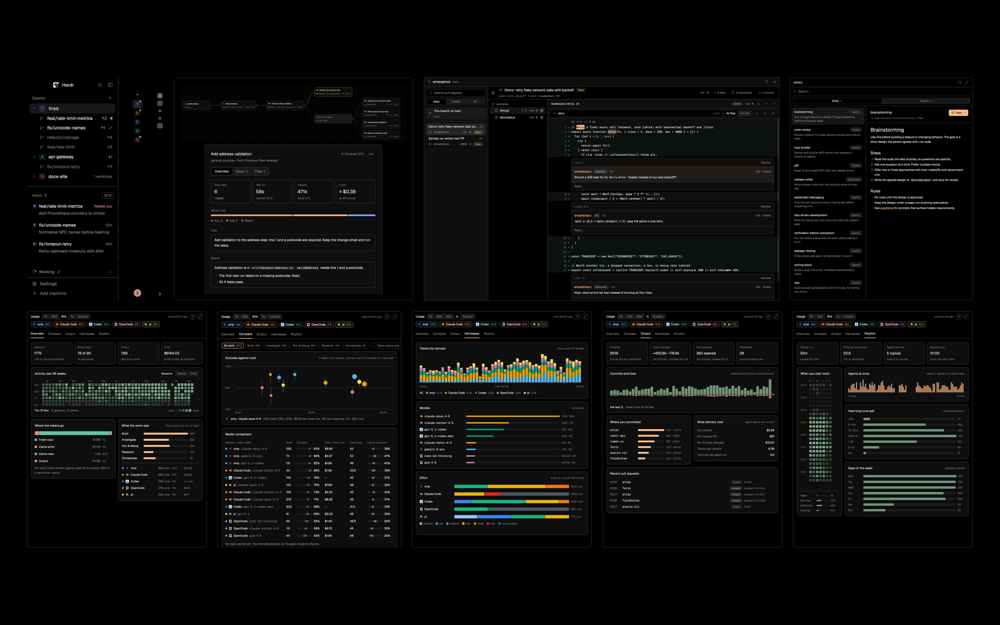

# Emergence

A layout for running many coding agents at once. The tab bar gains four side panels: every agent as a graph
(repo → worktree with its PR → agent → sub-agents), a pull request reviewer, a library of skills and Claude Code plugins,
and usage analytics across omp, Claude Code, Codex, OpenCode and pi. In the sidebar, an inbox holds a card for each
agent waiting on you and folds working ones away. For herdr-app 0.1.15.

To add it, run this repo's `install.sh` rather than copying the files: it links the mods to a git clone, so the tab
bar's Update chip can keep them current. A copy works but never updates.

## What you see

Left to right, no title bar, the theme's `canvas` behind cards, 1px `border` dividers:

- **Sidebar** (`chrome`; open 268px, folded to a 48px rail or 20px dots, by its width: under 34 dots, under 160 rail):
  - The brand row (46px, Herdr's `workspace-chrome`), hidden while folded.
  - **Spaces** (`spaces-plus`), sized by the inbox (`fitSpaces`) to the height Spaces publishes in
    `shared("spaces.want")`: 45px plus 30px a space, 28px a worktree row, plus 26px a machine header once there are
    several (rail: 26px a cell; dots: 22px a square, no header). It gives way while the inbox below lacks room for
    its content, but not below half the height the two share, never under 60px and never leaving the inbox under
    90px; before the inbox has measured, 285px at most. Rows past that scroll. The avatar is a soft tile: the space's
    colour at 15% with a 20% border, its letter in the colour, 18px, radius 5.
    - Under a repo's first main space: its other spaces' worktrees, then every worktree of the repo with no space yet,
      greyed (28px rows: branch icon, branch name in plain Geist 12.5px, ↑/↓ counts). An open worktree is matched by
      path or branch (git prints `/tmp` where rev-parse prints `/private/tmp`). A chevron folds a repo
      (`localStorage` `spaces.folded`); folded, it says "N worktrees". A nested space ends with its agent state:
      a 7px `blocked` dot, the still spinner (`working`) or a check (`done`).
    - Rail: a 32px cell per space (avatar, 7px status dot top right for blocked or working). Dots: an 8px square in
      the space's colour (55% unless active), in a 1.5px `blocked`/`working` ring when it needs you or is working.
      Folded, the top 36px stays clear for macOS's window buttons.
  - **Inbox** (`inbox`), the rest of the height. Its header is "Inbox N" (11.5px, `dim`) with a key chip on the right
    showing the binding of `tabs-plus.attention` (⌘⇧I).
    - Each row is 2 lines on an 8px-radius row: the program mark (14px), the branch (else the folder) in 12.5px
      `foreground`, and the age or "Needs you" (`blocked`); under it the task (12px `muted`), indented to the text.
    - At the foot, once anything is settled, a "Settled N" shelf.
    - With nothing waiting: a circle-check and "All caught up".
    - Folded: only the count of rows, at the foot: a 22px round `blocked` badge on the rail, the number on dots.
  - **Ports** (`ports`), right under the inbox's cards: "Ports N" header (41px, as the inbox's) and its rows (30px),
    or one 32px "Ports none" row; the slack below; then "Working N ›" (32px, spinner glyph, still), the sidebar's last
    row. The inbox sizes the block (`splitColumn`, with Spaces): what Ports publishes in `shared("ports.want")` (header,
    up to 5 rows, Working; from its row count alone) plus the room under the inbox's cards. Folded: 0px, no polling.
    - A row: what it is (a 14px `muted` Lucide icon from `kindOf`: app-window web, database, bug debugger, container
      Docker, plug other), `:port` in 12.5px, the process name (12px `muted`), and on the right a `dim`
      globe when your network can reach it, then who: the owner's program mark (12px; half strength when only
      probable) and its branch (else folder) in Geist 11.5px `dim`. A server no Herdr terminal owns says who started
      it, never "no agent" (`lib.js` `startedBy` / `byLine`, from its parent chain): an agent CLI on it and the app at
      its top ("Codex in iTerm", "Claude app"; Herdr is never the app), or "Claude ended" (the card: "Started by a Claude session that has ended") when its parent is gone and
      it runs in a Claude scratchpad, else its folder; then "· age", the age in `working` past an hour. An app or agent
      CLI on the chain also stops the folder guess (an outside app's server is never "probably" a Herdr agent's).
      Hover swaps the owner for an Open chip (web servers only).
    - The card (`port-card`, a 560px dialog sized by `lib.js` `cardHeight`: 308 owned, 338 orphan). Its words are
      decided in `ports/lib.js` (`ownerLines`, `stopFact`, `folderLabel`); the card only draws:
      - Title: kind icon, `:port` 15/600, process `muted`, the Esc chip.
      - Who, two lines: the program (500) and its space with the state on the right ("working", "needs you",
        "finished", "idle" in their colours), then what it's doing and the branch, or "Probably: it runs in this
        agent's scratchpad / worktree". For a server outside Herdr: "Claude app", "Codex in iTerm", "Started by a
        Claude session that has ended", "Started outside Herdr", then "in <worktree>" whole.
      - A `surface` box: the address with "This Mac only" / "Your network" and copy, then the command in `dim`.
      - Folder (only when it isn't the agent's; a scratchpad reads "Claude scratchpad/…", home as `~`, cut from the
        start), Running ("2d 20h · N% CPU · size"; an orphan's age in `working` past an hour), Also on.
      - Buttons: Go to agent / Go to terminal, Stop, Open. The Stop question states the deciding fact and never a
        verdict: "Stop Python (pid 8035)? Its Claude session has ended. Closes :18791 and :18792."
  - The footer (69px, `workspace-chrome {footer: true}`), hidden while folded.
- **Tab bar** (42px, `tabs-plus`, Herdr's tab bar): the space's tabs (settled ones hidden unless shown), `+`, then
  buttons for Files, Changes, Agents, PRs, Library and Usage. When the Emergence clone is behind GitHub's `main`, an
  "Update" chip (`accent` dot and text; "Update failed" in `blocked`) follows; clicking it pulls and reruns
  `install.sh`.
- **Main**: the active tab's panes.
- **Side panel** (368px, 280–4000, hidden until a button opens it; each panel keeps its own width: Agents 620, PRs
  860, Library 440, Usage 760): a stack of Files, Changes, `agent-graph`, `pr-review`, `skills`, `usage`, each with
  `{panel: true}`, in a 10px-radius bordered card.
- **Status bar** (28px, `status-plus`, Herdr's `workspace-status` plus this Mac's numbers): left as Herdr's; on the
  right, before the commands hint, CPU (`–` until two samples, then the mean of the last two, 10 s), memory used/total
  (GB), disk free (home volume) and battery (only on battery), each a 13px Lucide icon and 11.8px text, `muted`,
  `working` or `blocked` by level (CPU ≥ 80%; memory pressure warn / critical; disk free < 10% / 5%; battery < 20% /
  10%). Narrow bars drop battery (< 1100px), disk (< 900px), then the memory total (< 760px). A dim "This Mac" leads
  them when the space is on another machine.
  - Click one: **System**, status-plus opened as a centred 560px dialog (`props: { popup: true, tab }`): the
    Library's segmented tabs (CPU, Memory, Disk), a 15px headline with a `dim` caption and a 6px meter (`accent`,
    `working`, `blocked`), then "By agent" (32px rows: mark, branch, value; ≥ 1% CPU or ≥ 100 MB; click goes to the
    agent), "Everything else" (`dim`), and "Top processes" (8: name, a `:port` chip unless it's an agent's own, owner
    branch or —, value). Disk: free of total, then every worktree of the open terminals' repos by size (`du -sk`, one
    at a time, 30 s each, kept 5 minutes in `shared("system.du")`; "…" until measured, "too big to measure").
- A 0px `nav-keys` block in the work column.

Colours are theme tokens throughout. The data colours are fixed:
- Harnesses use Okabe–Ito: omp `#56b4e9`, Claude Code `#e69f00`, Codex `#009e73`, OpenCode `#cc79a7`, pi `#f0e442`.
- Effort runs blue→red: low `#3b82f6`, medium `#10b981`, high `#eab308`, xhigh `#f97316`, max `#dc2626`, not recorded
  `#4b5563`.
- Token kinds use Set2: fresh input `#8da0cb`, cache write `#fc8d62`, cache read `#66c2a5`, output `#e78ac3`.

Type is Geist, Herdr's interface font: no mod sets a font, as none of Herdr's own interface mods does. Monospace only for code itself:
PR review's diff lines and hunk headers, and the Library's code view; everything around them (branches, PR numbers,
file paths, commit hashes, counts) is Geist. Sizes: title 15/600, body 13, a name 13/500, secondary 12
`muted`, labels and section headers 11.5 `dim`, hints and chips 11 `dim`, buttons 12/500.

Dialogs (Emergence's own: confirm-safe, the port card, System, the keys list, settings and Delete worktrees; Jump and
the Library are palettes with their search field as the header) share one frame: `popover`, radius 10, 24px padding,
16px gaps, a 22px title row (15px semibold title, Herdr's "Esc" chip: 11px `dim`, `hover` background, closes on click),
sections headed 11.5px `dim` with their columns named at the same widths as the rows'. Buttons are 32px, 12/500, and
exactly one is filled: the one Enter presses (`solid`; a destructive one `blocked` at 18%), with ↵; ←/→/Tab move the
fill; the others are `raised` with an `input` border, Stop and Delete in `blocked` text. A destructive third choice
(confirm-safe's `extra`) stands apart at the far left in `blocked` text, ← from Cancel, never selected first, with a
`blocked` line under the box saying what it loses. A question or status sits left of the buttons (12 `muted`, two lines
at most), so asking never changes a dialog's height. A boxed subject is `surface` with a `border`. Widths: 440 (a
question), 560 (a card), 680 (a list or palette). Movable windows (`kind: "window"` with a `key`: drag one anywhere and it opens there next time; each
closes itself on Esc, since Herdr only does that for dialogs), centred the first time, as tall as their content where it's known
up front, else a fixed height (or a share of the window, as the keys list's 0.9) whose lists scroll inside.
Grouped rows (settings, the keys list) sit in one card per section: `surface`, a 1px `border`, radius 6, the header
6px above it, 18px between sections; rows divided by 1px `border` hairlines (settings: 36px, or 52px with a one-line
12 `muted` about, its whole text on hover) or a `p(4)` card of 28px rows (keys). The keyboard's row has the `hover`
fill, never a ring, and starts on the first row. A switch is `accent` when on, `raised` with an `input` border when off;
a choice is segments in a `raised` track, the chosen one `background`. Keys are 11px chips: `raised`, `input` border,
`foreground`. A list that scrolls keeps an 18px 12 `muted` footer of its keys. Each dialog's lib exports `DIALOG`
(pad, gap, title, radius, button); `mods/dialogs.test.js` fails when the copies disagree.

## How it behaves

- **Agent states.**
  - Inbox rows: blocked says "Needs you" in `blocked`, others their age; nothing animates.
  - Graph: the same colours on a still dot.
  - A done card turns idle once you look and stays a card until settled.
- **Inbox.**
  - Clicking a card focuses its agent (`agent.focus`).
  - Hovering swaps the age for **Settle** (`tab.settle`). Settled tabs go to the shelf; Herdr brings one back when its
    agent needs you. Clicking a shelf row shows the tab.
  - Sub-agents (started with `hc run --bg`) have no tab, so `agents()` misses them: the inbox adds them from
    `terminals()` (`lib.js` `subAgents`: live, with a parent, an agent program or a status report). A blocked one gets a
    "Needs you" card that peeks at it (`terminal.peek`); working ones count in "Working N".
  - "Working N" (drawn by `ports`, so it stays the last row) is always there (N may be 0) and opens the Agents panel.
    The panel's header has an Active | All switch with each view's count (Active: every agent but the idle; All: every
    agent), ← / → while it has the keyboard. However it's opened (Working N, ⌘⇧A, the tab bar) it opens on Active when
    an agent works or needs you, else on All (`agent-graph/lib.js` `openOnActive`), and nothing is remembered. On All, a
    6px dot by the Active count, with the count, takes `t.blocked` when an agent needs you, else `t.working` while one
    works (`activeNudge`); not once the person has switched themselves while agents were active, until all is quiet. The graph draws working agents in `t.working` (border and tint)
    as it draws blocked ones in `t.blocked`; a working agent's dot breathes (`.loop("opacity", { from: 0.4, to: 1,
    period: 1600 })`) and Working's spinner turns (`svg(spinner).spin(900)`), the only motion. Both are Herdr's native
    motion, never a timer (AGENTS.md: a timer redraws the whole window); they run only while drawn and something works.
  - The graph rings where you are, which `buildTree` (`agent-graph/lib.js`) marks `here`: while Inbox or Spaces has the
    keyboard, its cursor (shared `inbox.cursor` / `spaces.cursor`, null otherwise): an Inbox card marks its agent, a
    space the worktrees its agents work in, an unopened worktree row its own. Otherwise the focused terminal's agent.
    Active only still draws what the sidebar cursor marks, so its ring always has a card.
  - The sidebar's sections keep their own copies of one set of sizes (header 41, row 30, empty line 32, 14 under a
    list); `mods/sidebar.test.js` fails when the copies disagree. Inbox's height is `inbox/lib.js` `inboxHeight`.
  - The inbox order drives ⌘] / ⌘[ (`setAgentOrder`).
- **Ports.**
  - Every 5 s: `lsof -nP -iTCP -sTCP:LISTEN -Fpcn`, `ps -axo pid=,ppid=,etime=,comm=`, the listeners' folders
    (`lsof -a -d cwd`), and once per agent folder its git top-level. `lib.js` decides the rest, tested in `lib.test.js`.
  - Owner: the first of this computer's terminals on the process's parent chain (shell or agent pid from
    `terminals()`); else, for a process whose parent is gone, the agent whose worktree holds its folder (deepest
    root, then the most recent) or whose Claude Code scratchpad it runs in: "probable". A root of `~` or `/` claims
    nothing. Docker Desktop and OrbStack listeners are "docker" (no Stop: that would stop Docker).
  - Hidden: an agent's own port (the agent process itself listening), and a parentless process outside home and the
    temp folders, or an agent binary. One row per server: IPv4 and IPv6 sockets merge, a worker sharing its
    supervisor's port folds into the supervisor (`uvicorn --reload`).
  - The address is where it listens (`localhost` for every interface or both loopbacks, else `127.0.0.1`, `[::1]` or
    the IP). Ports never sends a request to a port (a login callback could take it as its answer): a table of
    database and debugger ports and names decides there's no Open.
  - Stop lives in the card (a mod command carries no arguments): Cancel selected, then `lsof -a -p <pid> -iTCP:<port>`
    must still show the port (else "already stopped", nothing killed), then `kill`, then a check each second for 10 s:
    "Stopped" (it closes), or "Still running" and a notice.
  - Keyboard: ctrl-j from the inbox (`ports.focus`; nothing when there are no ports), ↑ ↓, ↵ the card, ← the card
    asking Stop, ctrl-k to the inbox, ctrl-l / Esc back. The card returns the keyboard here on Esc (`emergence.over`).
- **Sidebar sizes (`tabs-plus`, in this layout only).**
  - ⌘B (`tabs-plus.rail`): folded or hidden → open at the last open width with the keyboard in Spaces. Open → fold to
    the last folded size (`shared("sidebar.folded")`, default rail) when the sidebar holds the keyboard, else only
    give Spaces the keyboard. There's no blur event, so it asks: `spaces-plus.toggle` folds (`tabs-plus.fold`) if
    Spaces' focus handle is focused, else `inbox.toggle` folds if the inbox's is, else `ports.toggle` if Ports' is,
    else `spaces-plus.focus`.
  - ⌘⌥B (`tabs-plus.thinner`): open → rail → dots → open; the folded size it lands on is remembered.
  - Folding hands the keyboard back to the pane `focused()` reports (it keeps reporting the terminal while a mod
    holds the keyboard). A saved 14px fold from before opens like any folded size.
  - Clicking the inbox's badge opens the sidebar.
- **Sidebar keyboard** (`"focusable": true` in both mod.json files, so `pane.go` reaches them too).
  - Spaces: ↑/↓ move an `accent` 1px ring (it stops at both ends; it stays on its row across refreshes, or moves to
    the nearest row above when its row goes), → unfolds and ← folds the repo under it, ↵ selects the space or opens
    the worktree (`space.new {folder, machine}`). Inbox: ↑/↓, ↵ focuses the agent.
  - On a worktree (greyed, or an open space in a linked worktree; not a main checkout: lib.js `actionTarget`), ←
    deletes and → archives, each after `confirm-safe` (Herdr's confirm with Cancel selected: Enter alone cancels;
    a short title, one sentence, the branch and its path (shortened in the middle) in a box, an amber line when a space closes, and a
    button named for the action, red for Delete). Every close gives the keyboard back to Spaces if it was there (the
    Focus rule below; asked by a click from the terminal, it stays in the terminal), and after a `space.close`
    Spaces takes it again 300 ms later (the next space's terminal grabs it).
    Delete: `git status --porcelain` first (dirty: a warning toast pointing at →, no dialog), then `space.close` if
    open and `git worktree remove` (the branch stays). Archive: shared `spaces.archived` (JSON [machine, path] → the
    space it closed), skipped by `addWorktrees`; reopening it in another space drops it from the archive (`reopened`).
    The archive confirm also offers Delete permanently (red, at its left: ← from Cancel, then ↵), dirty or not:
    `space.close` if open, then `git worktree remove --force` (the branch stays; the folder's uncommitted changes and
    untracked files go). Its red line counts them from the same `git status --porcelain` (`lib.js` `forceWarn`).
  - ⇧← anywhere in Spaces (or Delete worktrees… on a worktree's right-click) opens `worktree-sweep`, a 680px dialog
    listing every linked worktree of the repos Spaces knows (archived ones too; never a main checkout, a bare or a
    prunable one: `lib.js` `sweepItems`), the cursor's ticked. A 32px row: checkbox, branch (13/500), repo · open ·
    archived (12 `dim`), then its uncommitted changes from `git status --porcelain` (a 6px `blocked` dot and "3
    changes" in `blocked`, else "clean" `dim`; "couldn't check" counts as changed). ↑/↓ move, Space or a click ticks,
    ↵ asks once the ticked counts are in: the line under the list becomes the question ("Delete 3 worktrees? 1 has
    uncommitted changes: Delete skips it.") and the buttons Back (selected), Delete N clean, and at the far left in
    red Delete permanently, including N with changes (←/→/Tab). Its `lib.js` decides (`plan`, `choices`, tested).
    The plan goes back in shared `spaces.sweep` and `spaces-plus.sweep` runs it (the dialog is gone by then):
    `space.close` for open ones, then `git worktree remove` one at a time, `--force` only for a changed one on the red
    choice, dropping removed ones from `spaces.archived`; a notice says what went, what was skipped, what git refused
    (`sweepReport`). Never a branch.
  - Right-click on a worktree opens `row-menu` (Herdr's `menu` has fixed items): Open (greyed) or Rename and Close
    space (open), then Archive worktree… (→), Delete worktree… (←) and Delete worktrees… (⇧←), which run
    `spaces-plus.ask-archive` / `ask-delete` / `ask-sweep`; the target waits in `menuFor`. Main checkouts keep Herdr's space menu.
  - ctrl-j (Spaces → `inbox.focus`), ctrl-k (Inbox → `spaces-plus.focus`), ctrl-l and Esc (`pane.focus` on
    `focused()`). Not `pane.go`: it releases only a keyboard `pane.go` gave, not one a mod took itself.
    keys.json binds them in `mod:spaces-plus` / `mod:inbox` (`inbox.focus`, `spaces-plus.focus`, `<mod>.back`):
    a binding runs before `on_key_down`, so a global ctrl-j/k/l (`pane.go:*`) would otherwise take them.
  - The ring clears when the keyboard leaves: a 250ms timer compares `is_focused()` with what was drawn.
- **Keys** (`layout:emergence`: only the emergence layout shows tabs-plus; ⌘E is global). ⌘B and ⌘⌥B as above.
  - ⌘⇧A (Agents), ⌘⇧R (PRs: review), ⌘⇧K (Library) and ⌘⇧U (Usage) toggle the panels.
  - ⌘⇧/ (`mod.open:emergence-keys`, also a keyboard button after the panel buttons) lists every Emergence key: bound
    ones read live from `keys()`, the ones mods handle themselves as written (`emergence-keys/lib.js`). install.sh's
    SHADOWS lets it replace Herdr's global ⌘⇧/ (`app.help`, still on ⌘/).
  - ⌘⌥, (`mod.open:emergence-settings`, also a sliders button after the keyboard one) opens Emergence settings, a
    560×600 dialog of switches grouped by mod, each written at once to the shared value its mod already reads
    (`emergence-settings/lib.js` `sections`): Sidebar "Fold to dots" (`sidebar.folded` dots / rail), PRs "Side by side
    diffs" (`pr-review.split`), Library "Large skill window" (`skills.big`, clearing `skills.wsize` as the window's
    own toggle does), and Side chats a switch per harness (`side.harnesses`, only flipped supported ones saved; the
    names and the supported list come from side's resident copy in `shared("side.supported")`, since mods can't import
    each other). Not installed or no adapter yet reads "not installed" / "coming", no switch. ↑/↓ move an `accent`
    ring, ↵ or space flips, Esc closes. Herdr's own Settings (⌘,) has fixed sections no mod can add to (`frame/` is
    rewritten each start), hence a page of our own. Not on it: view state (panel widths, Usage's range and harness
    chips, folded repos, the graph's card positions: each copy's own `localStorage`, out of another mod's reach) and
    the Agents panel's Active | All, which is decided each time it opens.
  - ⌘⇧I (not ⌘⇧J: Homerow takes that system-wide for its scroll mode) puts the keyboard in the Inbox (`inbox.focus`),
    opening the sidebar first if it's folded; ↵ there runs
    `agent.focus` then `pane.focus` on that agent's terminal (pane.focus releases the Inbox's keyboard).
  - ⌘⇧O opens Herdr's Open worktree dialog for the focused pane's repo.
  - ⌘E opens Jump.
  - Opening a panel (its ⌘⇧ key or the tab bar) gives it the keyboard: tabs-plus sets `shared("emergence.opened")` and
    the panel focuses itself (clicking one does too). Inside every panel the same arrows: ↑/↓ walk the list (PRs and their
    files, skills, agents), ←/→ walk the tabs along the top, only while ↑/↓ walk that list and no text field has the
    caret (PRs: Open, Closed, All, not while a PR's files are open; Library: Skills, Plugins, with an empty search box;
    Usage: Overview to Rhythm, not in its date fields; Agents: Active, All), ↵ opens, Esc steps back and, with nothing
    left to step out of, gives the keyboard back to the terminal (`tabs-plus.back`; the panel stays open). In a
    window or popup Esc closes it.
- **Tab names.** tabs-plus renames an unnamed tab after its first terminal's branch, or its repo (else folder, `~` at
  home) when the branch is main, master, trunk or develop. It remembers the names it gave in `shared("tabs.auto")`,
  so a given name keeps following the branch while a name you give (`tab.rename`) stays yours.
- **Jump (`mods/jump`, ⌘E, a 680×640 dialog).**
  - Rows (`lib.js` `jumpRows`, tested), 28px, one line each. Untyped, "Recent" first: the last 3 tabs shown
    (`shared("jump.recent")`: tabs-plus puts each focused tab first, 100 kept), not where you are; the first is picked,
    so ⌘E ↵ goes back. Then "Spaces": every space as the sidebar nests them, from `spaces()` (already in the
    sidebar's order: spaces-plus moves them): a repo's main checkout, its worktree spaces under it, then its checkouts
    no space has open (`git worktree list` per repo, read in parallel, newest commit first; past 2, "N worktrees not
    open" and ↵ shows them; archived ones only while typing). A repo no space is in heads its own worktrees.
  - A space with one tab is one row (↵ selects the tab); with more, a row (↵ `space.select`) and its tabs under it.
    A row: mark (program icon, else folder or branch), name, dim branch, what the agent is on, and its state with how
    long ("working 12m", "needs you 3m"). The header counts spaces ("8 spaces", "2 of 8 spaces" while typing).
  - Typing filters on every word: names and branch, agent, title, state words ("needs you"), the folder counting
    least. Matches keep their parents (dimmed) and a matching space keeps all it holds; groups go by best match (a word
    starting a name first), else sidebar order; nothing reorders inside a group. A single branch-like word no checkout
    has adds "New worktree <name>" (Herdr's worktree dialog, action `new`), when the tab you're on is in a repo.
  - The highlight is the row's key (`rowKey`), so worktrees arriving late don't move it; ↑/↓ (`step`) pass the section
    labels. ↵ goes (a worktree opens with `space.new`), Esc leaves.
- **Agents panel.**
  - Cards for repos (15px semibold), worktrees (branch, ahead/behind, a PR chip) and agents (program
    icon, title without harness marks, state).
  - Click an agent to jump to it, a PR chip to open it in PRs, a repo to list its worktrees.
  - Drag a card to move it; drag empty space to pan; R resets the layout.
  - The wheel zooms, a trackpad scroll pans, ⌘-scroll zooms. The − / % / + control sits bottom-right, and the % fits.
  - A narrow panel shows the same tree as a list (indented rows, the same numbers, ▸/▾ to fold).
  - Keys: ↑/↓ select a card (worktrees and history cards too), ←/→ fold / open the selected one, A switches Active |
    All, ↵ focuses an agent (on a worktree or history card: folds it), F fits, R resets.
  - In-process sub-agents (Claude Code's Task/Agent, omp's `task`; Herdr sees only terminals, so these come from their
    logs through `subagents.py`) are cards under their agent, beside `hc run` ones, in both views (Active never drops
    one by itself, and a finished one never keeps its agent there). Running ones are cards of their own; every one the
    session ran that has finished sits under one history card per agent, "12 earlier sub-agents" with their calls and
    cost, folded by default; opened, their cards newest first. Only those finished within Emergence settings' Sub-agent
    history (1 day, 1 week or 30 days, the default and most: Claude Code deletes transcripts after that; `lib.js`
    `historySince`); the panel says it reads that (shared `agent-graph.historyOffered`), which shows the row. The card: the task's title; its state line
    "Working · <what it's doing now>" (a Bash call's description, omp's intent, else "Edit <file>") or "Finished 4m";
    "✎ N" edited files and its metrics in the dim slot. Hovering lists the files; the list view lists them under its row, worktree-relative, newest first, with a dot on those
    still uncommitted. A click (or ↵) opens its details (`detail.js`, the mod's own dialog: 680 × 0.9): title and state
    ("Working · <its newest step>" while it runs), type · "from <agent>" · its worktree, then three tabs (←/→):
    Overview (stat tiles: tool calls and how many failed, how long it ran, tokens and model, cost; "What it did", a
    bar of its calls by kind: Read, Edit, Run, Search, Web, Sub-agent; Task and Result, folded by length until Space,
    markdown drawn as headings, bullets and Geist Mono code), Steps (every call on a timeline: offset, kind dot, its
    label or a command's program ("git status", never its arguments), its target (a file's last two folders), duration
    or a red "failed"; three or more of a kind in a row fold into "Run · 25 calls ▸", a failure never; Space on a call
    reads its input and the first 40 lines of its output), Files (Edited, uncommitted marked, and Read). ↑/↓ move,
    Space opens, ↵ "Go to agent", Esc closes. `subagents.py --detail` reads the transcript when it opens and every 5 s
    while it runs, `--step` one call when opened; nothing is cached, and a transcript past Claude Code's ~30 days says
    so. Claude Code and omp alike (one reader per harness turns its lines into the same events); a sub-agent on another
    machine still focuses its agent. The large popup closes
    first. Read on each refresh and every 5 s while an agent or sub-agent
    works and the graph shows, in the refresh's task (no timer of its own); a redraw only when the answer changed.
    This computer only; pi, Codex and OpenCode aren't read yet.
  - Tool calls and cost: every agent and sub-agent card ends its state line with its own "⚒ 66 · ≈ $1.20" (`lib.js`
    `metricLine`); an agent's hover adds "with sub-agents: …". A worktree's chip row shows everything under it,
    cost first ("≈ $14 · ⚒ 900"). "$" is exact: omp's recorded cost, or Claude billed to an API key; "≈" is Claude
    on a subscription priced at API list prices (what Claude Code itself computes; hover: "at API prices
    (subscription)"); a sum with any estimate in it is "≈". A model with no listed price shows tokens ("1.2M tok"),
    and a sum missing some prices ends in "+". Money: "$0.42", "$12", "$1.2k"; tokens "980", "12k", "1.2M".
  - Folding: a chevron on the right edge of any card with something under it (worktree, agent, history card) folds
    its subtree; a folded worktree or agent carries a summary chip on its bottom edge ("3 agents · 5 sub-agents ·
    ≈ $14"; a click opens it), and folding never widens the graph, so folded agents let a 620px panel draw the graph
    instead of the list. Live work starts open, history folded; choices are kept in the mod's localStorage
    (`folds`). The header's fold button collapses every card while any is open, else expands all (history too).
  - Overlap: a file two live writers (agents, running sub-agents) in a worktree both edited in the last 15 min and
    haven't committed puts a ⚠ chip (`t.blocked`) on both cards and the file (+N) on the worktree card's chip row
    (`lib.js` `overlaps`).
  - Behind the graph, a fine film grain gives the canvas depth (`mods/agent-graph/grain.png`, 512px, light and dark
    specks, tiled at 256px at 10% by default (Settings → Grain, Off to 25%), fixed to the viewport); working and blocked cards are an opaque
    blend (`lib.js` `mix`), so nothing shows through them. Header icon buttons have no box, as in every panel.
- **PRs panel.**
  - GitHub or GitLab: the likelier by the origin remote first (`forgeOrder`: a `github` host → GitHub), else the other
    (a GitHub Enterprise host or ssh alias needn't say "github"); main.js calls `s.api`. The Agents graph likewise runs
    `glab mr list` for a non-GitHub remote and falls back to `gh`. GitLab:
    `glab api --paginate --output ndjson` for reads (plain `--paginate` glues pages as `][`), no `--paginate` on writes;
    a line comment POSTs `position` as one JSON value with `old_line` and/or `new_line` (both on an unchanged line),
    base/start SHAs from the MR version its head belongs to (`versions`), and a range as `line_range` whose ends carry
    `old_line`/`new_line`, the line's type and its line code (`sha1(path)_<old>_<new>`, each number the line's place on
    that side: lib.js `linePos`); codes alone collapse to the last line after the next push. Read back, both ends are
    on one side. MR lists are one page of 100 per state, last updated first, and carry no +/- counts (blank). An outdated thread (written at an older head) gets no line, as on
    GitHub; GitLab's old version's numbers only label it ("was line N"), and with no commit to carry it from it stays
    apart from the diff. Verified live on a throwaway MR: every line kind, range, reply, edit, delete, resolve, MR comment,
    tag badge.
  - Shows the focused repo's PRs (Open, Closed, All, search) and, first in the sidebar, the compare: `[head ▾] vs [base ▾]` on
    one line (the head shortens first), with "Includes uncommitted changes" under it (this branch) or "Committed changes
    only" (a picked branch). Click the row to show it; click a side's ▾ to pick that branch in a picker that opens right under the
    row, in the sidebar (local and remote branches, `git for-each-ref`, most recent first, filtered as you type, ↵ takes
    the first; the head's list starts with this branch and its uncommitted work). Picking shows that compare at once.
    The sidebar is the only place to pick: the diff's header has no compare bar. ← / → walk Open · Closed · All only
    while ↑ / ↓ walk the PR list, never while they walk a PR's files (`lib.js` `tabArrows`). Picks are kept per repo in `shared("pr-review.heads")` / `shared("pr-review.bases")`.
    The diff runs from the two sides' merge-base; the default branch diffs from `origin/<base>` when it can, a picked
    branch as named.
  - Changed files form a folder tree with +/− and comment counts; one file's diff shows at a time; ↑/↓ steps files.
  - Unified or side by side (the file header's columns button, shared by every copy; a narrow panel stays unified):
    side by side puts the old line left and the new right, a deletion run paired line for line with the additions
    after it (`pairRows` in lib.js), blank (`surface`) where a side has none, a 1px divider between.
  - Lines longer than the code column scroll sideways (trackpad, shift-wheel, or a 6px bar along the bottom); the line
    numbers and comment cards stay put. A Find match past the edge scrolls into view.
  - Select lines by click, shift-click or drag. The comment box then docks under the diff with tag chips: Statement
    (green), Question (blue), Nit (purple), Minor (yellow), Major (red). A tag posts as
    `` on its own line, then the comment.
  - Outdated threads (a later push changed their line; GitHub gives `line: null`) are carried to the head: once per
    commit and head, `GET repos/<nwo>/compare/<originalCommit>...<head>` (`github.js` `compare`), and `lib.js`
    `carryLine` takes `originalLine` through that file's patch: an unchanged line to its new number, a deleted one to
    the next new line in its hunk (what replaced it), else moved by the lines added and removed above (`carryThreads`;
    a compare that isn't `ahead`, as after a force-push, carries nothing). The card hangs under that line with an
    "Outdated · was line N" chip (never on whatever code now has the old number). One with nowhere to go stacks above
    the file's first row and shows the last 4 lines of the hunk it was written on (`diffHunk`), drawn as diff lines. A
    resolved outdated thread folds to one row with both chips, like any resolved one.
  - Reply, edit, delete and resolve threads. Esc steps back out. Comment authors are in accent; @mentions (users,
    org/teams, not in code) render as profile links (`mentions` in lib.js).
  - Conversation: "N comments" in the header swaps the changes for the description, the comments on the PR itself and
    the reviews with a verdict (chip: Approved, Changes requested, Dismissed) or a note, oldest first, with tag chips
    and a box that posts a PR comment (`POST repos/<nwo>/issues/<n>/comments`, ⌘↵). A badge in any of them shows as
    its chip. Your comments have Edit (with tag chips: add, change or drop the badge) and Delete, as on a thread
    (`PATCH`/`DELETE repos/<nwo>/issues/comments/<id>`); the conversation stands in for a thread (`TALK`) in the same
    draft and busy state. ⌘F there searches it (author or text; the card tinted, ↵ scrolls to it). They come with the
    review threads, in one GraphQL query. Commits and Conversation share the header's slot (`d.pane`); Esc closes
    either.
  - Live: every 5 s while it shows, the threads and conversation refetch; the diff follows when the PR's head has moved
    past the one shown (this branch: every 5 s, from the working tree), unless a commit, a selection or a draft is open
    (it catches up after). The diff's head (`d.at`, the `commit_id` a new comment is posted at) is read with `viewPR`
    (`headRefOid`; GitLab's MR `sha`) just before the diff, so a push in between only makes the diff newer and the next poll refetches it.
    Threads fetched at a head wait (`d.next`) until the diff shown is that head's (`lib.js` `settle`), so a newer
    head's line numbers never land on an older diff's rows; the conversation shows at once. The PR list refreshes every 30 s. A hidden panel doesn't poll, nor does the panel while the
    window is open (one set of GitHub calls: about 840 GraphQL points an hour of the 5,000).
  - Find (⌘F, or the search button on the file's header): a bar over the diff, All files (the default) or This file,
    smart case (an upper-case letter makes it exact); ⌘F again selects the query. It matches diff lines (each hit
    marked) and review comments by author or text (the comment tinted; a resolved thread opens), in drawn order.
    ↵ / ⇧↵ step through matches, opening each one's file with it a third of the way down; All files puts each file's
    match count in the tree and dims the rest. Esc closes it.
  - Commits: "N commits" in the header lists them, oldest first, under "All changes" (`gh pr view --json commits`;
    `git log` for this branch). One opens its own diff (`gh api` with `Accept: application/vnd.github.diff`; `git show`)
    under a bar with Commit i of N, ‹ ›, and All changes; [ / ] step. Comments, their counts and the comment box stay
    on All changes, because their lines are the whole PR's. A refresh goes back to All changes.
  - Hidden lines: a hunk header with lines hidden above it reads "N lines" (unfold icon) and shows them on click; a
    "Rest of the file" row after the last hunk does the same, and the file header's unfold button shows the whole file.
    The lines come from the new side, fetched once per file (`gh api …/contents/<path>?ref=<head or commit>` raw; for
    this branch the working tree, or `git show <commit>:<path>`), and splice in as muted context rows that can't be
    commented on (GitHub only takes lines in the diff). Not for added, deleted or binary files.
  - Room: the panel-left button left of the PR title hides the PR list (and brings it back); the header's « goes full
    size: the sidebar folds away as ⌘B does (`tabs-plus.rail`), the terminal keeps the sidebar's old width on the left and the panel takes
    the rest; » puts all of it back. ⤢ opens the same PR in a window.
  - The window opens unkeyed (a keyed window reopens wherever it was last dropped) at the centre, 94% × 90% of the
    screen; ⤢ always opens it that big (a hand-made size only lasts until then).
    It's frameless, draws its own 10px border and shadow, and resizes from the right and bottom edges and that corner
    (Herdr can't place a window, so the left and top stay put), pressing gives it the keyboard so Esc still closes it,
    min 640×420, never past the screen; the size is kept in `shared("pr-review.wsize")`. A window `mod.open` puts up
    (agent-graph's deep link, the CLI) hands over to a centred one at once.
- **Excalidraw panel.**
  - The whiteboard (`mods/excalidraw`, SOURCE.md): open drawing, tools across the top, zoom and file at the bottom. It
    follows `data/excalidraw/open.json`: that names the drawing it shows, it starts from it (the last drawing only when
    none is named), and writing another path there opens that one, fitted to view; an outside change to the open file
    reloads it, fitted. Only the panel copy reads or writes the file.
  - Theme: a dark theme draws on black, panels in the theme's colours, every colour through Excalidraw's dark-mode
    filter (`theme.js`: invert 93%, hue-rotate 180°; files keep their own colours); a light theme draws on white in
    Excalidraw's own light panels. A theme switch rebuilds the canvas.
  - Bottom right, a card: **All drawings ⌘O** (also `mod.open:excalidraw`, "Open…") and, in the panel, **Full size**: the
    drawing in an 0.92 × 0.88 window (`open.js` openWindow, key `excalidraw-big`) with the house title row and Esc chip;
    Esc closes it once nothing is selected. Pinch and ⌘-scroll zoom about the pointer; zoom, scroll and the redrawn
    layers change in one step (at most one redraw per 40 ms, the steps in between folded in), so nothing flickers.
  - Under the drawing, the Agents graph's background (`backdrop.js`, its copy, kept equal by a test; `ground.js`): the
    same Settings rows, Grain, Background and Background strength. Plain patterns build in render from cached tiles;
    fading dots, gravity and topographic follow the boxes (rectangles, ellipses, diamonds, images; not arrows, words or
    frames around other boxes), build with their paths in a timer step of their own (topographic at full size ~15 ms,
    paths ~13 ms), slide with any pan since and hide while a zoom catches up. Ink: the panels' foreground.
  - The library (`library-view.js`, ported from the retired Diagrams library: `library.js` sections, search, repo keys,
    trash; `store.js` the folder, `index.json` written compare-and-swap, fingerprints from one `stat` listing so only
    changed drawings are read; `preview.js` outline SVGs in one ink): a 680 × 640 movable window. This repo | Pinned |
    All, search, ↵ opens in the panel (or the big window without one), ⌘S pin, ⌘R rename, ⌘K repos, ⌘⌫ trash (30
    days); the selected row has buttons for each, Duplicate too. Herdr's global ⌘P / ⌘D are left alone. Choose
    folder… opens the mod's own folder picker (`props.picker`), which sends a drawing to the panel or a new tab; never
    `pane.split`. A drawing's repos: the index's, plus any it names in `appState.herdr_repos`.
  - Agents: skill `herdr-excalidraw` (`dot2excalidraw.py`: DOT laid out by Graphviz, every box sized by the panel's text
    metric and fixed, arrows bound, clusters as frames; `--into` adds beside what's drawn, `--open` shows it).
- **Library panel.**
  - Skills and Plugins tabs. Plugins are the installed Claude Code plugins; open one to see the skills it ships.
  - A skill opens in one reusable, frameless window (SKILL.md, references, scripts) that resizes from the right and bottom
    edges and remembers its size; a bigger/smaller toggle snaps it back to a preset.
- **Usage panel.**
  - Range: 7d, 30d, 90d, 1y, or Custom: two typed `YYYY-MM-DD` dates, or two clicks on the calendar, both days
    included.
  - Harness chips filter everything.
  - Rescans the logs when it shows and every minute while it shows (about 1.5 s: only changed logs are read); `output.py`
    (git, and gh, whose calls share the agents' GitHub budget) reruns with it at most every 15 min, and on ↻.
  - Tabs:
    - **Overview:** tiles for sessions, cost (and per day), agent commits (and cost per commit) and clean runs, each
      against the period before only when the history covers it (`tiles.before`). "Day by day" (weeks past a month):
      stacked areas by harness of sessions, cost or commits, straight with a dot per day up to a month, smooth beyond,
      a day label under each point up to two weeks. The year's calendar, its cells growing to fill the card (11 to
      18px), days outside the period grey at their level, its readout the period's totals and busiest day. "Where the
      spend went": the top four projects (scan.py's `where`: the repo's name, a removed worktree's repo, "temporary
      folder", "home folder") and the rest in one row, so it adds up to the Cost tile. "What the work was": all six
      kinds, and per harness its runs, cost per run and spend. "Where the tokens go", its legend on one row.
    - **Compare:** kind-of-work chips and Same repos only; a success-vs-cost scatter (log x, dot size = runs, 95%
      interval line, each price under its own point); a model comparison table; the cost anatomy. "Strengths by kind
      of work" (`strengthsOf`): pairs with 10+ sessions, the six busiest. A grid of pairs by kind, each cell tinted by
      its clean-run rate, the best per column outlined; then a radar per pair with each kind's numbers beside it, two
      to a row. A kind needs 5 runs, else it's skipped (a gap in the shape, a dashed spoke), and best and weakest go by
      the low end of the rate's interval.
    - **Output:** commits, lines, PRs/MRs, worktrees; added/removed bars; top repos; spend per commit, merged PR and
      1K lines; recent PRs.
    - **Harnesses:** tokens by harness as stacked areas, models, effort.
  - Charts: Herdr mods get no chart elements (gpui-kit's charts are Rust-only, and there's no web view), so
    `charts.js` draws them with `PathBuilder` and `window.paint_path`: stacked areas in a vertical gradient of each
    harness's colour, its top line only where the layer is more than a sliver, and radars. The geometry (monotone
    curves that can't overshoot, stacking, radar points) is pure, in `geom.js`, tested by `geom.test.js`.
    - **Skills:** which skills do well. A skill counts when Claude Code calls its Skill tool, or another harness's
      agent reads its `SKILL.md` (a listing in a prompt, a glob or a write doesn't; a plugin prefix is dropped; `scan.py`
      records `skills` per session). Tiles: sessions with a skill, skills used, median cost with and without one,
      categories. A table per skill, or per category (Code review, Planning and design, Testing and debugging, Writing
      and explaining, Browsing, Other: from how a word of the name starts, `lib.js` `categoryOf`): sessions, the share
      that led to a commit, median cost, clean runs. Each is shown against the same harnesses' sessions without it, with
      ▲ / ▼ at a 20% difference; rows under 5 sessions are dimmed. Click a row for its harnesses and models.
      Correlation, not cause; a session using several skills counts for each (`lib.js` `skillsOf`).
    - **Rhythm:** a vertical hour grid (hours down, weekdays across, 11px squares) with a time-of-day split beside it,
      agents at once, run lengths, days of the week.
  - Hovering any bar or square writes its numbers into a line under the chart. Tooltips on tiny cells don't show in
    Herdr.
  - Picking narrows every other number (tiles, cards, harness chip counts, every tab) until cleared. Press a day on the
    calendar (not in Custom, where clicks set the range) or a bar (Tokens by harness, Agents at once, Commits and
    lines) for days; press an hour-grid square, an hour label (that hour every day) or a weekday letter for hours of
    the week. Drag or shift-click spans, cmd-click adds or removes, pressing the whole pick again clears it. The chart
    picked on stays whole with the rest dimmed to 30%; an accent chip right of the tabs names the pick (✕ clears).

## Built from

- **`layouts/emergence.json`**, a clone of `main` 0.1.15 (`titlebar: none`, `traffic_lights: [12, 16]`):
  - root row → `sidebar` column (`brand` workspace-chrome; `sidebar-lists` column of `spaces` spaces-plus px 75 min 60
    `inbox` inbox weight 1 min 90 and `ports` ports px 32 min 0; `sidebar-footer` workspace-chrome `{footer: true}`)
  - `work` column (`tabs` tabs-plus 42px; `work-body` row of `main` and a `panel` column → `panel-body` stack of
    files, changes, graph, prs, skills, usage; `status` status-plus; `nav-keys` 0px `{resident: true}`).
- **`mods/tabs-plus`** (clone of `tabs`):
  - PANELS `[id, label, icon, width]`; remembers each panel's width and per-space choice; hides settled tabs.
  - `nextCommand` handles `graph`, `prs`, `skills`, `usage`, `attention`, `rail`, `thinner`, `fold`, `back`, `worktrees` and `update`.
  - Tab names (`autoName`, one `git rev-parse --show-toplevel` per folder, again after 30 s if it couldn't run; a rename
    not landed in 10 s is sent again) and `jump.recent`, both from `render`.
  - Updates: finds the clone with `git -C <appHome>/mods/tabs-plus rev-parse --show-toplevel` (the mod is a link into
    it), only on `main` with this repo as `origin`; at start and every hour, `git fetch` of the public HTTPS URL into
    `origin/main` (an ssh origin would ask for a passphrase); behind with no local commits shows the chip. Its click
    runs one `bash -c`: fetch again, `git merge --ff-only`, `install.sh`, and `layout.switch` main → emergence when
    `mods/` or `layouts/` changed since the last whole update (`refs/emergence/updated`, so a retry after a
    half-done one still reloads) and emergence shows. A pull into the clone isn't a save Herdr sees (the mods are
    links), and switching to the shown layout is a no-op, hence the detour. `install.sh` run by hand does the same
    detour when emergence already shows, and prints how to reload by hand if a switch fails.
- **`mods/inbox`**: `agents()`, `terminals()` (parent), `panes()` (cwd, branch), `spaces()` (tabs, settled,
  changed_at), `keys()`, `focused()`, `shared("spaces.want")`, `setAgentOrder`, `run("agent.focus" | "tab.settle" |
  "tab.select" | "tabs-plus.rail" | "tabs-plus.fold" | "spaces-plus.focus" | "ports.toggle" | "pane.focus")`, and
  `layout.resize` for the Spaces and Ports blocks. Commands `focus`, `toggle`.
- **`mods/ports`**: `exec` (`lsof`, `ps`, `git`), `terminals()` (pid, foreground, machine, parent), `agents()`,
  `panes()`, `spaces()`, `openOverlay` (`port-card`), `shared("ports.open")`, `setShared("ports.want")`,
  `run("tabs-plus.graph" | "tabs-plus.fold" | "inbox.focus" | "spaces-plus.focus" | "pane.focus")`. Commands
  `focus`, `back`, `toggle`. `lib.js` (`parseLsof`, `parsePs`, `ownerContext`, `owner`, `servers`, `urlFor`, `isWeb`,
  `blockHeight`, `subAgents`, …) is pure and tested.
- **`mods/status-plus`**: Herdr's `workspace-status` (bar.js) and the System popup (popup.js), picked by props in
  main.js. `exec` (`ps`, `vm_stat`, `sysctl`, `df`, `pmset`; the popup also `lsof`, `git worktree list`, `du`),
  `terminals()`, `panes()`, `agents()`, `openOverlay` (itself), `run("agent.focus" | "pane.focus" | "app.palette")`,
  `setShared("ports.open" | "system.du" | "emergence.over")`. `lib.js` (parsers, `cpuSample`, `byAgent`, `segments`,
  `level`, …) is pure and tested; ownership is the parent chain only.
- **`mods/port-card`**: props `{ server, who, ask }` from ports; `exec` (`ps`, `lsof`, `kill`), `open_url`,
  `write_to_clipboard`, `run("agent.focus" | "pane.focus" | "tab.select" | "terminal.peek")`, `notify`,
  `setShared("emergence.over")`. `lib.js` copies ports' `parseLsof` / `holds`.
- **`mods/spaces-plus`**: a clone of `spaces` with soft avatars, worktree rows (`lib.js`: `parseWorktrees`,
  `parseTrack`, `addWorktrees`, `nearest`, tested in `lib.test.js`), folding, the keyboard and the rail and dots
  sizes. Per main checkout it runs `git worktree list --porcelain` and
  `git for-each-ref --format='%(refname:short) %(upstream:track)' refs/heads`; a machine that stops answering keeps
  its last list. Commands `focus`, `toggle`, and for its dialogs `archive`, `delete`, `force-delete`, `sweep` and the
  row menu's `ask-*`.
- **`mods/worktree-sweep`**: the bulk delete dialog. Props `{ items, ticked }` from spaces-plus, `exec` (`git status
  --porcelain` per row), `setShared("spaces.sweep" | "emergence.over")`, `run("spaces-plus.sweep")`. `lib.js`
  (`plan`, `tally`, `question`, `choices`, `tick`, `step`) is pure and tested.
- **`mods/excalidraw`**: coyaSONG's Excalidraw mod (MIT) as copied from herdr-orca, bundling `@excalidraw/math`,
  `common` and `element`; our parts are `theme.js` and `handoff.js` (tested in `excalidraw.test.js`), called from lines
  in `main.js` marked `// herdr-mods:`.
- **`mods/agent-graph`**: `lib.js` builds the tree and lays it out. It runs `git rev-parse` per folder (30s cache) and
  `gh pr list` per repo (60s), and draws edges with `PathBuilder` + `window.paint_path`. `subagents.py` (python3
  stdlib, tested by `test_subagents.py`) takes the local claude and omp agents (`{address, pid, harness, top}`) and
  prints their sub-agents and recent edits: Claude by pid → `~/.claude/sessions/<pid>.json` → `~/.claude/projects/*/
  <sessionId>/subagents/agent-<id>.jsonl` + `.meta.json`; omp by tty → `~/.omp/agent/terminal-sessions/<tty>` → the
  session's `<session>/<Task>.jsonl` (nested a level down; `__*` skipped). Edited = Edit/Write paths plus the files a
  Bash call changed (`bashEditDiff`), omp's edit/write paths; uncommitted from `git --no-optional-locks status --porcelain -z` (no index.lock while agents commit). Each log
  is read from a byte offset kept in `data/agent-graph/subagents-2.json`, with its totals; a first read takes the
  whole log, skipping lines that hold nothing it counts (an agent's own transcript: only usage lines before its last
  8 MiB), and a finished sub-agent's entry drops the ids it deduplicated by. Metrics: Claude counts `tool_use`
  parts by call id and usage once per `message.id` (a message is written once per content block, and may repeat far
  down the log; `api-request-blob` lines repeat calls and are skipped), including the advisor's requests in
  `usage.iterations`; an agent's own transcript counts only its session's records (a resume copies the earlier
  session's in). Cost = tokens at the Claude API list prices in `PRICES` (one table, dated, longest model-id prefix;
  cache writes x1.25 for 5 min, x2 for 1 h, `speed: "fast"` x2); `<synthetic>` costs nothing. "api" when the agent's
  environment (`ps eww`) holds an ANTHROPIC_API_KEY whose last 20 characters are in `~/.claude.json`
  `customApiKeyResponses.approved`, else "estimate". omp: `usage.cost.total` as recorded, `toolCall` parts. Checked
  against Claude Code's own `cost-state` on this machine: within about 1% of a $1,092 session (its sub-agents
  included); the rest is side requests Claude Code doesn't write to the transcript.
- **`mods/pr-review`**: `github.js` (gh api) and `gitlab.js` (glab api), the same functions and shapes; `gitlab-map.js`
  maps GitLab's JSON to them (pure, tested); `lib.js` parses diffs, builds the file tree and handles tag bodies.
- **`mods/skills`**: finds skills with `find` and reads `~/.claude/plugins/installed_plugins.json`.
- **`mods/usage`**:
  - `scan.py` (python3 stdlib, `git`, optional `zstd`) turns the harness logs into one record per session (tokens by
    kind, cost, effort, tool calls by kind, errors, aborts, commits) and caches them in `data/usage/cache.json`. A
    session's commits are the `git commit` calls its agent and its sub-agents ran, counted from the transcript (so a
    removed worktree keeps them, and another session's commits never count). New or
    changed logs are parsed across processes once there are 32 or more (a first scan: about 8 s for 8 GB of logs, was
    27 s on one).
  - `output.py` lists your commits (`git log`, no diffs), diffs only commits it hasn't counted before (`git show
    --numstat`; a commit's counts never change, kept in `data/usage/commits.json` for the year's window), then runs
    `gh pr list` or `glab mr list` and `git worktree list`.
  - Every copy shares one scan (a copy opened mid-scan waits for it), and the sessions show as soon as `scan.py`
    returns; Output fills in after `output.py`. While nothing is read yet the panel counts the seconds, and past 5 s
    says why ("The first scan reads every session these harnesses have kept…").
  - `lib.js` does the maths: Wilson intervals, quartile levels, cost anatomy, rhythm.
  - `main.js` draws with divs only.
- **`programs.json`**: gives omp its icon (`mods/inbox/omp.svg`, omp's MIT favicon).
- **`keys.json`**: `layout:emergence` ⌘⇧A/R/K/U/J/O, ⌘⇧/, ⌘⌥/, ⌘⌥, (settings), ⌘B and ⌘⌥B; `global` ⌘E
  (`mod.open:jump`). The layout section beats `global` and still applies while a terminal is focused (only a
  `terminal` binding for the same key would shadow it).
  `install.sh` drops the keys it used to add (`RETIRED`: ⌘⇧G, old ⌘⇧U, ⌘⇧M, and the panel keys in `global`) while
  they still hold its value, but only once that action's new key is theirs or free to add; then it adds the new ones.

## Watch out

- Merge `programs.json` into `~/.config/herdr-app/programs.json` too (Herdr's add flow only names `keys.json`).
  Without it, omp shows the generic agent icon.
- **Cross-mod paths.** Usage uses `mods/inbox/omp.svg` and `mods/agent-graph/refresh.svg`/`expand.svg`; Jump uses
  `mods/agent-graph/branch.svg` and reads tabs-plus's `jump.recent`. Inbox and the graph call `tabs-plus.*` commands.
  If a name clashes and you rename a mod, rename these references too.
- **Programs and files outside each mod's folder.**
  - `agent-graph`, `pr-review`: run `git` and `gh`, and post to GitHub on comment actions. `agent-graph` also runs
    `python3` on its `subagents.py`, which reads `~/.claude` and `~/.omp` session logs and `~/.claude.json`, and runs
    `ps` and `git status`; only file paths, short labels (a Bash call's description, omp's intent) and counts and
    costs come out, never commands or prompts. It reads a Claude agent's environment (`ps eww`) only to tell whether
    an approved API key bills it: just that yes / no leaves, never the key or any part of it.
  - `skills`: reads the skill folders.
  - `usage`: runs `python3` on its own scripts, which read `~/.omp`, `~/.claude`, `~/.codex`, `~/.local/share/opencode`
    and `~/.pi` session logs and run `git`, `gh` and `glab`. Only counts, models and timestamps are read, never prompt
    text.
- **Focus rule: closing something gives the keyboard back to where it was.** Herdr does this only for a keyboard
  `pane.go` gave; one a mod took itself (⌘B, ⌘⇧I, a panel's key) goes to the terminal when a dialog closes. So:
  - Our dialogs and menus (Jump, the keys, `confirm-safe`, `row-menu`) set shared `emergence.over`
    `{at, open: true}` in `init` and `{at, open: false, went}` in `close()` (which also runs when Herdr closes them
    on Esc or a click outside). Spaces, the Inbox and the Agents, PRs and Usage panels each keep `comeBack`: had the
    keyboard at the last frame when one opened → focus again 80 ms after it closes, unless `went` (a Jump row picked,
    a menu item that opens something of its own) or the next one is already up (menu, then confirm). They notice
    losing the keyboard on a 250 ms timer (no blur event). Started from the terminal, nothing takes it.
  - A panel's own window or popup (skill window, PR window, Agents or Usage opened large) sets shared
    `emergence.back` (a timestamp) in its `close()` when it goes for good (not when replaced); the side panel showing
    focuses itself on seeing a new one. Each panel reads the current value in `init`, so only later closes count.
  - Not covered: Herdr's own dialogs (⌘⇧O worktrees, ⌘/ keys, a space's menu, a sub-agent's peek) and any dialog over
    the Library, whose keyboard is in its search box (a handle can't see that, and the box's focus and blur events
    don't fire). Those end in the terminal.
- **Gotchas that bit the first build.**
  - `on_size_change` reports zoomed px: divide by `settings().zoom`.
  - A collapsed column counts as not shown, so `<mod>.<command>` fails there. That's why `nav-keys` and every command
    live in the work column, and ⌘B lives in tabs-plus.
  - An invisible window takes every click: host resident mods in a 0px block.
  - `hc keys` presses keys only after ~3 s without a person's keypress (bound keys count), so nav-keys gives Neovim
    its ctrl-h/j/k/l over its socket (`nvim --server … --remote-send`) and keeps `hc keys` for vim.
  - More in `docs/platform-notes.md`.
- **Limits.**
  - Usage's first scan reads every log (about 8 s on a heavy machine, in parallel); later runs read only what changed.
  - Output looks back one year.
  - "Led to a commit" counts your own commits from the run's start to at most 8h + 30min later.
  - The kind of work is a heuristic over tool calls.
  - Codex records no cost.

## Done when

- `herdr-app check` passes for agent-graph, inbox, jump, nav-keys, pr-review, skills, spaces-plus, tabs-plus and usage.
- `herdr-app do layout.switch --name emergence` shows Spaces and an Inbox in the sidebar.
- `herdr-app do tabs-plus.graph`, then `.prs`, `.skills` and `.usage`, each open their panel. `bun test` passes in
  agent-graph, pr-review, skills, spaces-plus and usage, and `python3 mods/usage/test_scan.py`, `python3
  mods/side/test_side.py` and `python3 mods/agent-graph/test_subagents.py` pass.
- A terminal printing `\033]7501;state=blocked:app=claude\033\\` shows a "Needs you" row. `tabs-plus.thinner` then
  folds to the rail with a count badge, again to dots with the number, and once more opens the sidebar.
- With a repo open as a space and another worktree of it (`git worktree add`), that worktree shows greyed under it;
  opening it as a space turns it into a nested space row, never a second row.
- `python3 mods/usage/scan.py | head -c 50` starts with `{"scanned_at":`.
