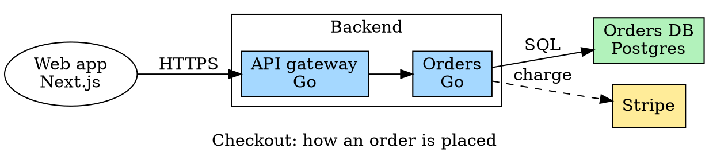

# Herdr Excalidraw

A drawing is one `.excalidraw` file (Excalidraw's JSON). Herdr's Excalidraw panel (Excalidraw in the top bar) shows one and reloads the moment its file changes. `~/.config/herdr-app/data/excalidraw/open.json` names the drawing open there: `{"file": "/absolute/path.excalidraw"}`; writing another path into it opens that one.

## Steps

1. **Find the file.** Read `open.json`. When the user means the drawing in front of them ("on this", "add to it"), that file is yours: read it. For a new drawing, use `~/.config/herdr-app/data/excalidraw/<repo>-<topic>.excalidraw`, lower case with hyphens, one that isn't taken: the user's library (All drawings ⌘O) lists that folder. Done when you know which file you'll write.
2. **Plan the picture.** One question it answers, one main direction, boxes grouped into frames. Budget: about 12 boxes per drawing and 6 per frame; past that, two drawings (an overview and a close-up).
3. **Draw it.**
   - Boxes and arrows (most diagrams): write DOT and let the converter lay it out. It sizes every box for its words, has Graphviz place the boxes and route the arrows, binds arrows to boxes, turns clusters into frames, and puts the new group to the right of anything already drawn:
     ```sh
     python3 ~/.claude/skills/herdr-excalidraw/dot2excalidraw.py diagram.dot --into "$FILE" --open   # add to a drawing
     python3 ~/.claude/skills/herdr-excalidraw/dot2excalidraw.py diagram.dot -o "$FILE" --open       # a new one
     ```
   - A small change (a note, one box, a colour, a move): edit the JSON yourself, by the rules below.
4. **Check it.** `python3 -m json.tool "$FILE" > /dev/null` passes; ids are unique; every bound text and arrow is listed back by its shape. Done when all three hold.
5. **Tell the user** what you drew and that it's in the Excalidraw panel.

## DOT for the converter



- **Frames group by meaning** (a layer, a service, a stage): a `subgraph cluster_<name>` with a short `label`.
- **Words:** a box names a thing and how it's built, two lines of at most 22 characters each (break with `\n`: nothing wraps for you). An arrow's label says what flows, three words at most; leave it off when obvious. `style=dashed` for asynchronous or optional.
- **Shapes:** `box` (a rounded rectangle) for services and steps, `ellipse` for people and start/end, `diamond` for a decision (sparingly). Other shapes draw as rectangles.
- **Colours** come from Excalidraw's palette, written for a white canvas (in a dark theme the panel shows the drawing as Excalidraw's dark mode does, so never pre-invert). Fills: blue `#a5d8ff` services, green `#b2f2bb` data, yellow `#ffec99` external, red `#ffc9c9` risks. Lines and words stay `#1e1e1e`. Using three or more fills, add a small legend frame.
- **Layout:** `rankdir=LR` or `TB` for the main direction; `constraint=false` on an arrow running against it; peers side by side with `{rank=same; a; b;}`. The converter's spacing is roomy; raise `nodesep`/`ranksep` if arrows still bunch.

## Editing the JSON yourself

- **The file is shared.** Keep every element you didn't add, change only yours, and write the whole file back in one write. If the user had unsaved strokes, the panel keeps them in its undo.
- **Elements** need `id` (unique), `type` (`rectangle`, `ellipse`, `diamond`, `text`, `arrow`, `line`), `x`, `y`, `width`, `height`; give `strokeColor`, `backgroundColor` (`"transparent"` or a palette fill), `fillStyle: "solid"`, `strokeWidth: 2`, `roughness: 1`, and `roundness: {"type": 3}` on rectangles. The panel fills in the rest.
- **Words in a shape** are a `text` element with `containerId` set to the shape's id, `textAlign: "center"`, `verticalAlign: "middle"`, `fontSize: 16`, `fontFamily: 5`, and the shape lists it in `boundElements` as `{"id": <text id>, "type": "text"}`. Make the shape big enough: width at least characters × 8.8 + 40, height at least lines × 20 + 28.
- **An arrow** has `x`, `y` at its start and `points` relative to that, the first `[0, 0]`. It binds with `startBinding` / `endBinding` = `{"elementId": <shape id>, "focus": 0, "gap": 6}`, and each bound shape lists `{"id": <arrow id>, "type": "arrow"}` in `boundElements`.
- **Room:** at least 40px between shapes; nothing overlaps.
- **Its repo:** the converter files a drawing under the repo you ran it in (`appState.herdr_repos`, comma separated, `~` paths). Making one by hand, set that yourself, e.g. `"appState": {"viewBackgroundColor": "#ffffff", "herdr_repos": "~/code/shop"}`.

## Reference

The file format: <https://docs.excalidraw.com/docs/codebase/json-schema>. Graphviz attributes for the DOT: <https://graphviz.org/doc/info/attrs.html>.
